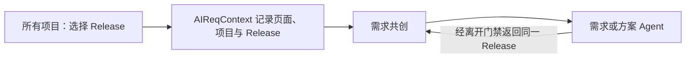

# 分区导航与想法池

需求共创按项目和 Release 列出需求，每行展示最新文档版本及确认状态，详见[需求共创](proposals.md)。

## 导航与范围

工作台仅面向电脑浏览器，使用展开文字侧栏。品牌区使用 AIReq 蓝色双对话标记及“AI 需求协作”“AI Requirements”两行文字。品牌中文标题使用 `text-ui-lg`、英文使用 `text-ui-sm`，Logo 32px，品牌区高 64px。品牌下首先显示全局导航。「所有项目」「想法池」和「角色管理」保留全局导航和侧栏底部入口，隐藏版本工作区。角色管理在页面内选择项目，开发和测试名单复用想法池的卡片表面、行间分隔和右对齐操作列。进入项目页面后，全局导航下显示版本工作区，命名的项目及 Release 选择器在上，版本页面在下。原生 Select 选择器固定在版本导航滚动区之外，整行可点击，下拉对齐触发器，长名称截断并保留完整 title。加载、无项目与无 Release 的禁用／占位保持，版本页面共享一个具体 Release。

| 位置       | 入口                       | 范围                         |
| ---------- | -------------------------- | ---------------------------- |
| 全局       | 所有项目、想法池、角色管理 | 所有项目；角色管理在页内选项目 |
| 版本工作区 | 需求共创                   | 当前项目与具体 Release       |
| 页脚       | 账户、设置                 | 现有账户菜单与设置覆盖层     |

当前页面使用选中底色、较强字重及 `aria-current="page"`，键盘焦点独立可见。两个 Agent 会话均归属需求共创，返回列表时保留原范围。

进入需求共创或 Agent 时，焦点落到当前页面标题。从 Agent 返回需求共创时优先聚焦原需求入口，条目已离开当前筛选范围时聚焦列表标题。

工作台顶部提供“跳到主内容”跳过链接：默认 sr-only，键盘聚焦时可见，激活后聚焦并滚动主内容区；不新增导航 owner，不改变鼠标布局。

`AIReqContext` 唯一持有项目、Release、对象、主页面、浏览器历史及未保存门禁。首页「进入工作区」通过 `openProject(projectId, releaseId)` 选择项目和指定 Release，直接打开需求共创。版本工作区可见性由主页面推导。切项目保留页面类别，详情回对应列表；优先恢复本会话该项目上次有效版本，否则选择创建时间最新的版本。无版本显示空态及设置入口。显式对象链接同步对象所属项目及 Release。无显式对象链接时，登录和刷新进入「所有项目」。需求链接包含项目、Release、IR、可选 SR 和 Agent；SR 仅在浏览器定位文档，会话仍按项目、IR 和 Agent 读取。缺项、归属错误或对象不存在时明确报错。

`navigationState.ts` 校验浏览器历史中的页面和覆盖层。主区进入 Agent 使用当前需求和明确的 Agent 选择，表格查看文档只影响侧栏。



导航、切范围、设置往返及历史消费既有草稿门禁；取消或保存失败不改变已接纳选择和历史。目标投影未就绪显示读取中，失败显示错误与重试，不用前一目标快照推断空版本、零统计或缺材料。同目标后台重读保留已读内容、滚动和未处理的提交错误，迟到结果不得覆盖新目标。丢弃草稿后只继续一次原导航，在途保存期间不重复提交或丢弃。

## 页面与正文

1100×700 的电脑窗口内，侧栏全部业务导航首屏可见；压缩分组间距与导航行留白，保留范围选择器和必要时的纵向滚动。

项目已加载且没有可用 Release 时，需求共创在主区统一显示「暂无 Release」和「配置 Release」。入口沿 Shell 的项目配置请求定位当前项目，由用户创建 Release。返回时恢复原页面，入口仍可用时将焦点交还给它。新建需求和从想法池转入都需要指定 Release。加载中、读取失败及已有 Release 但结果为空各自显示对应状态。侧栏 Release 选择器显示「暂无 Release」。

Agent 工具栏提供「返回需求共创」，经离开门禁回到同一项目和 Release。验收覆盖 1100×700 的文档阅读、Atlas 无版本时需求共创的配置入口及往返，以及 1440×900 完整布局。

列表及设置共用 `shell/pageLayout.ts` 和原生 `SETTINGS_FRAME_CONTENT_CLASSNAME`：正文在实际剩余面板内居中、`max-w-4xl`、左右 `px-4 lg:px-8`，一级标题使用外观页标题角色。外层滚动与正文限宽分离，表格仅局部横滚。

所有项目、想法池和需求共创保持共同标题基线。版本工作区的侧栏显示当前项目及 Release，并提供范围选择器。两个 Agent 会话的页头提供返回和查看文档，输入框提供按需评审。会话链接包含项目、Release、需求和 Agent。

卡片与数据表使用 `bg-card`／`border-card-border`；标题、主要数值与想法池原文使用主文字，需求原文摘要、版本确认信息、想法提交信息和说明使用次级文字。粘性表头使用不透明卡片底色。重复范围和过程解释进入已有帮助或 disclosure，错误、过期和操作门禁仍直接可见。

输入占位符（含 Select 未选值与聊天输入器占位）使用次级文字 `foreground-subtle`，在所属输入表面保持 ≥4.5:1 对比；`foreground-subtlest` 只用于徽标、刻度等弱元信息，不承载字段说明。

业务流程帮助（工号菜单入口）说明如何从「所有项目」打开指定版本的需求共创。

## 所有项目

- 首页显示项目及 Release。每张版本卡片展示「已定版需求」和「未定版需求」的数量，「进入工作区」直接打开该版本的需求共创。以最新版的确认记录划分，暂无文档或最新版未确认的需求归入未定版。两项计数均显示零值，并随工作流刷新。无版本项目可以从本页配置。
- 每个项目分组铺满正文列，版本卡片在宽面板使用两列，窄面板单列。默认展示最近两个版本，其他版本通过展开查看。
- 标题、数量及卡片本身没有点击动作。动效主题保留现有卡片悬停反馈和展开过渡。

需求共创表格展示需求名、原文和最新文档版本。「文档版本」显示「Vn · 已定版」及该版本的确认人和确认时间，或显示「Vn · 未定版」「暂无文档」。最新版未定版且已有确认快照时，附「上次定版 Vn」。确认时间使用北京时间，历史定版记录可从文档区查阅。需求标题提示保留提交人和提交时间。每行提供「需求 Agent」「方案 Agent」及成组的「查看文档」和「复制同步命令」图标。名称等于原文时显示一次。命令预览与复制规则见[同步已定版文档到本地分支](proposals.md#同步已定版文档到本地分支)。

需求共创表格在窄主区把版本和确认记录作为一组放到需求摘要下方，操作可换行并保持原字号。打开右侧文档时留在列表并聚焦所选文档标签。列表高亮已展开的需求，随右栏展开收窄时将该行保持在表格视区，收起后回到打开文档的行入口。方案 Agent 无参与权限时仍可聚焦以读取原因，激活不会进入方案。各入口的可访问名称包含对应需求。

页头操作、筛选栏和表格外边线对齐。筛选栏含需求搜索、提交人和定版状态两个下拉。提交人选项取自当前项目及 Release 的全部需求，去重后按工号排列，选择后精确匹配。定版状态可选全部、已定版或未定版，其中未定版包含暂无文档和最新版未确认。三个条件一起生效，修改条件回到第一页，筛选无结果可直接清除筛选。切换项目或 Release 清空筛选，同一范围往返会话保留筛选。筛选结果计数位于表格底部左侧。多页结果在同一行右侧提供分页控件，翻页从新页顶部读起并保留键盘焦点。

窄主区的项目与 Release 放到页面标题下面，新建按钮继续与标题同行。新建成功的回执显示保存的需求名称及「继续讨论」。同一范围的筛选继续生效。新需求未匹配当前筛选时，回执解释原因，并提供「清除筛选并定位」，点击后打开目标所在页并将焦点交给该行的需求 Agent 入口。验收包含已有查询时保存一条不匹配的需求，以及展开右栏导致表格重新换行时的行定位。

验收覆盖登录落在「所有项目」、「所有项目」和「想法池」隐藏版本工作区、键盘或鼠标从 Release 卡片一步进入需求共创且范围一致、从项目页面打开「角色管理」后隐藏版本工作区且仍可在页面内选择项目。浏览器前进／后退恢复页面、项目及 Release。零需求的 Release 仍可进入并新建需求，无 Release 的项目仍可配置。深浅主题及宽窄电脑窗口检查标题对齐、焦点和页面宽度。

## 全系统在线人员

侧栏底部、当前工号上方提供“在线人数”入口，不受项目或 Release 选择影响。入口复用 ghost 按钮与侧栏图标／文字基线，以侧栏辅助文字显示标签、主文字右对齐显示“N 人”，末尾使用次级右箭头提示可查看名单；32px 行高，悬停、弹窗打开及键盘焦点均有清晰反馈，不添加装饰状态点或循环动画。读取中显示“在线人数…”，失败显示“在线状态暂不可用”，两者均不显示人数。点击打开复用现有 Dialog 的居中弹窗，宽 640px、最大高度 70vh，仅显示“工号／访问 IP”两列；固定不透明表头，名单内部滚动，IPv6 完整换行。无搜索、分页、头像、逐行在线标记或其他操作；关闭按钮、Esc 和遮罩关闭后回焦入口。人数按工号去重，包含自己；行按工号与 IP 去重并稳定排序，同一工号的多个 IP 分行显示。工号非可信认证，不将人数称为已认证用户。

连接事实由服务端 AIReqPresence owner 持有，仅接纳校验成功并已打开的 WebSocket；注册／注销幂等，同 IP 多连接按引用计数，最后一条连接关闭才删除该行。只读快照 readPresence 与 presence 事件复用现有 AIReq Channel RPC，携带进程内递增 revision，事件不触发业务工作流重读。客户端先订阅再读，忽略迟到旧版本，每 15 秒补读以恢复暂时读取失败；不得自动重放写命令。断线由既有 main 连接 owner 管理；读取失败显示“在线状态暂不可用”，不将旧数值当实时结果。进程重启清空连接表，当前单进程部署不宣称跨实例汇总。

IP 取宿主 requestIP，缺失显示“未知”；默认忽略转发头。ZCODE_TRUSTED_PROXY_IPS 以逗号配置精确可信代理 IP，仅当直连来源在该列表时，从右向左剥离可信 X-Forwarded-For 地址，取首个不可信来源；非法链退回直连地址。连接保活使用 WebSocket ping/pong，60 秒空闲超时清理失联连接，不依赖用户操作，不保存访问历史。

```text
WebSocket open／close → 服务端 presence owner → 去重快照 revision → presence 事件
客户端订阅 → readPresence → 版本核对 → 人数入口与弹窗只读投影
```

验收覆盖两个工号实时互见、同工号多标签与多 IP 去重、关闭／切工号移除、伪造转发头不生效、可信代理链、迟到快照、真实长名单滚动不跳位置、IPv6、浅深主题、键盘焦点与弹窗关闭。在线数据只来自连接，不生成演示名单。

## 主页面对象标识展示

所有项目、想法池、需求共创默认只展示可读业务内容，不在名称列或摘要中渲染内部对象 ID，也不将其称为业务编号。名称不足时不以内部 ID 兜底；保留需求名称、状态、人员工号和时间。

表头与搜索提示使用原始需求或名称；现有内部 ID 精确检索能力保留用于已有定位流程，不另造展示编号。操作按钮的无障碍名称使用对象名称与动作。对象 ID 仍用于内部关联、导航和详情追溯；不改服务契约、数据身份或状态所有者。

验收：逐页检查默认列表与 Release 卡片无内部 ID；通过 SR 链接仍能定位对应文档；筛选、展开和详情操作指向原对象；浅深主题均保持可读。

## 全局想法池

想法池保存尚未排期的原始需求，无需项目、版本或日期。切换侧栏项目或 Release 不改变其全局范围。支持新增、查看／编辑、按原文搜索、CSV 导入导出及转入版本；编辑不改变原提交人和提交时间。

想法池标题下说明可先记录未排期需求，确定后再转入项目版本。新增成功后显示「想法已保存」及查看入口。编辑仅在原文改变且非空时允许保存。离开新增或编辑草稿时提及尚未保存的原文，离开转入草稿时提及目标版本。

点击原文打开编辑；原文为行内主要文字，提交人、时间退居次级。窄分栏将提交信息并入原文下方。末列保留常显、可键盘聚焦的三点菜单，提供“转入项目版本”。转入弹窗使用同一标题，说明可选择同一项目或不同项目的多个版本，全部转入成功后原想法移出想法池、每个目标版本生成一条独立提案；中英文含义一致。取消／Esc 返回实际入口，转入成功消费原行后回到“新增想法”。多目标表单的项目／版本标签按同一目标序号配对，删除后重新编号。

一次可转入一个或多个不同的项目与 Release 组合。转入只为每个组合创建一条归属该 Release 的独立 IR，保留原始短需求、提交人和提交时间。全部目标成功后移出原想法，用户留在想法池。保存和转入回执须滚入当前视野；转入回执按目标提供「需求 Agent · 项目 · 版本」，打开对应 IR 的需求会话。目标版本的顺序与所有项目卡片一致，标记最近版本。有目标不可用时整批不创建需求，保留原想法和已选目标。没有可用 Release 时引导项目配置。

`createIdea`、`updateIdea`、`transferIdea`、`importIdeas` 沿用既有 command、连接身份、operationId、expectedRevision、想法 revision、严格 schema 及幂等收据。转入的全部目标校验、提案创建、想法移除与收据属于 workflow 同一事务；空目标、重复组合、错归属、缺失目标或旧 revision 均整批拒绝。同操作同输入返回原收据，不同输入拒绝复用；重连只重读，不自动重放写入。失败保留原文、目标及操作 ID，显式重读基线不自动接纳已变化的想法。

CSV 为 UTF-8 单列“原始需求”，支持引号、逗号及单元格内换行；跳过空行，重复正文提示但不去重。导入先预览文件名、有效条目、空行、重复行和原文，确认前不写入；非空批次任一无效则全批拒绝。导出当前搜索匹配的全部原文，不导出编号、提交信息或生成材料，空结果禁用；导出文件可重新导入为新想法。

导入文件、预览、原文和未提交目标归当前 UI 草稿，纳入唯一离开门禁。文件读取使用代次拒绝迟到结果；读取／提交中禁用重复确认，失败保留输入，取消和关闭恢复入口焦点，不静默丢弃。

## 实现依据

- `packages/ui/src/aireq/shell/AIReqSidebarNavigation.tsx`、`AIReqShell.tsx`、`pageLayout.ts`
- `packages/ui/src/aireq/AIReqContext.tsx`
- `packages/ui/src/aireq/projects/AIReqProjectDocumentsPage.tsx`、`packages/ui/src/aireq/proposals/AIReqProposalTable.tsx`
- `packages/ui/src/aireq/ideas/AIReqIdeaPool.tsx`、`AIReqIdeaImportExport.tsx`

右侧对象详情与材料入口见 [统一右侧工作区](unified-side-pane.md)，设置门禁见 [工具与设置](tools-settings.md)。
