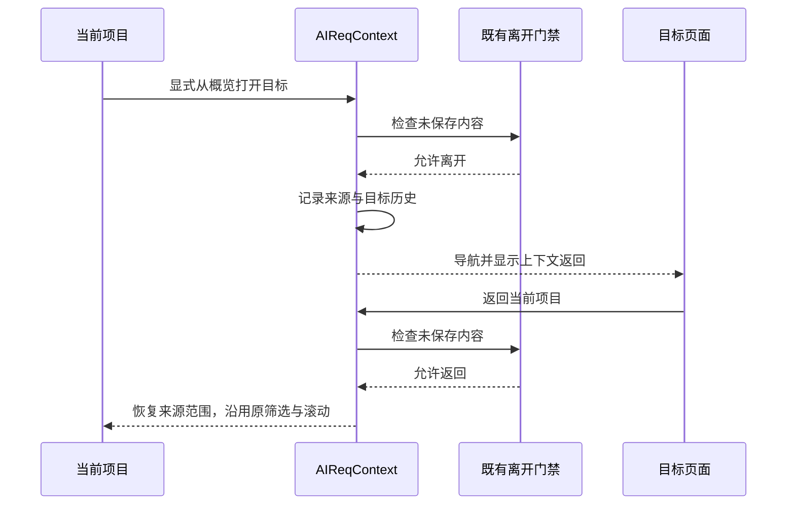

# 分区导航与想法池

提案列表及项目摘要统一使用[需求提案八态](proposals.md#提案业务状态)，状态由当前材料、评审和确认事实推导；“已转正”对象仅进入正式文档列表，不作为提案状态。

## 导航与范围

工作台仅面向电脑浏览器，使用展开文字侧栏。品牌区使用 AIReq 蓝色双对话标记及“AI 需求协作”“AI Requirements”两行文字。品牌中文标题使用 `text-ui-lg`、英文使用 `text-ui-sm`，Logo 32px，品牌区高 64px。品牌下首先显示全局导航。「所有项目」「想法池」和「角色申请」保留全局导航和侧栏底部入口，隐藏版本工作区。角色申请的目标项目由申请页内的选择器指定。进入项目页面后，全局导航下显示版本工作区，命名的项目及 Release 选择器在上，版本页面在下。原生 Select 选择器固定在版本导航滚动区之外，整行可点击，下拉对齐触发器，长名称截断并保留完整 title。加载、无项目与无 Release 的禁用／占位保持，版本页面共享一个具体 Release。

| 位置       | 入口                                   | 范围                     |
| ---------- | -------------------------------------- | ------------------------ |
| 全局       | 所有项目、想法池                       | 全部项目                 |
| 版本工作区 | 项目概览、需求共创、正式文档、版本待办 | 当前项目与具体 Release   |
| 页脚       | 账户、设置                             | 现有账户菜单与设置覆盖层 |

当前页面使用选中底色、较强字重及 `aria-current="page"`，键盘焦点独立可见。提案讨论和角色任务归属需求共创，正式详情归属正式文档。历史中保存的开发或测试列表入口恢复到同一 Release 的需求共创。全局与版本范围由分组、入口名称和具名选择器表达。点击全局「所有项目」返回首页。

进入版本概览及需求工作台或任务时，焦点落到当前页标题。由需求工作台返回提案列表时优先聚焦原提案入口，当前筛选或分页中找不到该条目时聚焦列表标题。新建表单关闭遵循[提案创建的焦点规则](proposals.md#创建与导入导出)。

工作台顶部提供“跳到主内容”跳过链接：默认 sr-only，键盘聚焦时可见，激活后聚焦并滚动主内容区；不新增导航 owner，不改变鼠标布局。

`AIReqContext` 唯一持有项目、Release、对象、主页面、浏览器历史及未保存门禁。首页「进入工作区」复用 `openProject`，一次导航选择对应项目、具体 Release 及项目概览；版本工作区可见性由主页面推导。切项目保留页面类别，详情回对应列表；优先恢复本会话该项目上次有效版本，否则选择创建时间最新的版本。无版本显示空态及设置入口，不借其他项目数据补齐。显式对象链接同步对象所属项目及 Release。无显式对象链接时，登录和刷新进入「所有项目」。需求链接包含项目、Release、IR 和可选 SR，缺项、归属错误或对象不存在时明确报错。

`navigationState.ts` 仅提供历史字段校验与来源推导的纯函数，状态接纳仍归 `AIReqContext`。需求工作台由 `AIReqContext` 的同一导航历史保存根返回来源：当前项目来源使用下述带项目／Release 校验的上下文返回；从需求共创进入时根返回提案列表。任务先返回工作台，独立审查详情先返回所属汇总，再沿根来源返回。正式需求仍返回正式文档列表；详情内阶段切换和设置往返保留来源，浏览器前进／后退恢复该记录。直接分享链接没有来源时按对象类型回到提案或正式列表，不把全局总览当来源。返回按钮及提示明确目标，沿既有导航和未保存门禁执行，不用无条件 `history.back()`。当前项目在同一项目／Release 内保留挂载，局部筛选与滚动由页面自身持有；加载投影或隐藏时不覆盖已保存滚动，回到可读内容后恢复。切项目／Release 重新建立该页面局部状态。


导航、切范围、设置往返及历史消费既有草稿门禁；取消或保存失败不改变已接纳选择和历史。目标投影未就绪显示读取中，失败显示错误与重试，不用前一目标快照推断空版本、零统计或缺材料。同目标后台重读保留已读内容、滚动和未处理的提交错误，迟到结果不得覆盖新目标。丢弃草稿后只继续一次原导航，在途保存期间不重复提交或丢弃。

### 项目概览的上下文返回

从项目概览的统计、“查看全部”或需求入口进入其他主页面时，记录来源项目及具体 Release。目标内容区左上角显示轻量 `← 返回项目概览`，与正文列左边缘对齐，放入既有 48px 顶部空间；列表标题和正文起点不随入口显示／隐藏移动。提案讨论不额外显示上下文返回带；返回统一放入聊天顶部工具栏，与右侧对象菜单和材料入口同一行，沿用原来源及门禁。右侧详情 Tab 不增加重复返回入口。

来源由 `AIReqContext` 的导航状态唯一持有，随同一会话浏览器历史记录及恢复，不放入公开链接、业务数据或本地持久存储。刷新、直接对象链接和直接侧栏进入不产生来源；点击侧栏（包括当前已选页面）、切项目或 Release 清除来源。来源仅在项目与版本仍匹配且存在时有效，设置覆盖层往返不清除。

返回走既有设置／草稿门禁，明确选择来源概览而非盲目后退；取消留在原页面且来源保留。概览保持挂载，保留当前范围内筛选、展开和滚动位置，不缓存业务投影；范围变化重新挂载，采用新范围默认展示。浏览器后退／前进恢复相应历史项的来源，不借另一身份或页面伪造返回入口。



验收覆盖：侧栏直达与概览进入的标题坐标相同；返回恢复范围、筛选及滚动；同页侧栏点击及切范围清除入口；设置往返、浏览器前后退、刷新和直链行为符合来源规则；未保存表单取消／放弃离开正确。深浅主题及宽窄电脑窗口检查对齐、焦点和无页面横向溢出。

## 页面与正文

1100×700 的电脑窗口内，侧栏全部业务导航首屏可见；压缩分组间距与导航行留白，保留范围选择器和必要时的纵向滚动。

项目已加载且没有可用 Release 时，需求共创、正式文档和版本待办在主区统一显示「暂无 Release」和「配置 Release」。入口沿 Shell 的项目配置请求定位当前项目，由用户创建 Release，返回时恢复原页面。选择具体 Release 后才可新增、导入或转入提案。加载中、读取失败及已有 Release 但结果为空各自显示对应状态。侧栏 Release 选择器显示「暂无 Release」。

提案工作台及任务工具栏的返回按钮直接显示返回目的地文字，沿同一导航来源与门禁执行；相邻页面标题不能代替按钮文案。待办主区不足 640px 时，处理角色与归属并入事项摘要，需求和事项换行，分工入口保持可见。验收覆盖 1100×700 的文档阅读和待办操作、Atlas 无版本时三个页面的配置入口及往返，以及 1440×900 完整布局。

列表、当前项目及设置共用 `shell/pageLayout.ts` 和原生 `SETTINGS_FRAME_CONTENT_CLASSNAME`：正文在实际剩余面板内居中、`max-w-4xl`、左右 `px-4 lg:px-8`，一级标题使用外观页标题角色。外层滚动与正文限宽分离，表格仅局部横滚。

所有项目、项目概览、想法池、需求共创、正式文档、版本待办保持共同标题基线。四个项目级首页在标题旁以次级文字显示当前项目和具体 Release，长名称在窄面板换行或截断并可查看全称。切换范围时只展示已就绪的同范围投影，无 Release 保留配置空态；全局首页不附项目范围。选择器仍唯一位于侧栏。无概览来源的提案讨论详情不保留列表的顶部占位；提案工作台与任务共用顶部工具栏：工作台返回原来源，任务返回工作台，审查详情返回所属汇总；右侧为对象菜单和任务内材料入口。任务及审查参数由 Context 导航历史与对象 URL 持有，不新增业务状态。不再另占标题编号栏，也不显示复制链接。返回保持具名提示、来源规则和原导航门禁。正式详情保留自己的顶部布局。

卡片与数据表使用 `bg-card`／`border-card-border`；标题、主要数值与想法池原文使用主文字，提案标题下的原文摘要、提交人、日期和说明使用次级文字。粘性表头使用不透明卡片底色。重复范围和过程解释进入已有帮助或 disclosure，错误、过期和操作门禁仍直接可见。

输入占位符（含 Select 未选值与聊天输入器占位）使用次级文字 `foreground-subtle`，在所属输入表面保持 ≥4.5:1 对比；`foreground-subtlest` 只用于徽标、刻度等弱元信息，不承载字段说明。

业务流程帮助（工号菜单入口）说明如何从「所有项目」进入指定版本，再从工作区打开版本待办及其他项目页面。

## 所有项目

- 首页显示项目及 Release。版本卡片展示提案和正式文档数量，提供「进入工作区」进入对应项目概览。无版本项目可以从本页配置。
- 每个项目分组铺满正文列，版本卡片在宽面板使用两列，窄面板单列。默认展示最近两个版本，其他版本通过展开查看。
- 标题、数量及卡片本身没有点击动作。动效主题保留现有卡片悬停反馈和展开过渡。

需求共创以提案名称作为首列具名工作台入口，名称旁常显进入箭头，原文摘要紧随其下。点击名称或原文、键盘聚焦入口后按 Enter 均经已有导航进入同一提案；名称等于原文时只展示一次。工号、日期为次级信息，状态独立成列，不重复设置同义操作列。

需求共创列表在主区容器（`@container/conversation`）宽度不足 640px 时进入紧凑呈现：将提交人和日期并入提案单元格次级行，保留提案名、原文和状态，宽面板恢复完整列。

验收覆盖登录落在「所有项目」、「所有项目」和「想法池」隐藏版本工作区、键盘或鼠标进入指定 Release 后范围与概览一致、从项目页面打开「角色申请」后隐藏版本工作区且仍可在申请页内选择项目、版本待办默认「我的」、返回「所有项目」及浏览器前进／后退恢复页面和范围。有零提案的 Release 仍可进入，没有 Release 的项目仍可配置。

## 项目概览与版本待办

项目概览按当前项目与 Release 展示提案数量、正式文档数量、待人工确认的提案及最近提案。待确认按 IR 去重，保留需求评审及方案三方的分类，同一提案可出现在多个分类。最近提案按真实业务更新时间展示最多五条，入口进入提案工作台。

版本待办按当前项目和 Release 筛出可处理事项，显示角色和归属，并提供带数量的「我的」「待认领」「全部待办」。切换项目或 Release 后默认回到「我的」。若当前筛选无结果而同范围仍有事项，空态提供切换筛选入口并移动键盘焦点。无项目、无版本、加载、失败及暂无待办各自明确。项目概览的待确认统计面向本 Release 全体人员。

## 全系统在线人员

侧栏底部、当前工号上方提供“在线人数”入口，不受项目或 Release 选择影响。入口复用 ghost 按钮与侧栏图标／文字基线，以侧栏辅助文字显示标签、主文字右对齐显示“N 人”，末尾使用次级右箭头提示可查看名单；32px 行高，悬停、弹窗打开及键盘焦点均有清晰反馈，不添加装饰状态点或循环动画。读取中显示“在线人数…”，失败显示“在线状态暂不可用”，两者均不显示人数。点击打开复用现有 Dialog 的居中弹窗，宽 640px、最大高度 70vh，仅显示“工号／访问 IP”两列；固定不透明表头，名单内部滚动，IPv6 完整换行。无搜索、分页、头像、逐行在线标记或其他操作；关闭按钮、Esc 和遮罩关闭后回焦入口。人数按工号去重，包含自己；行按工号与 IP 去重并稳定排序，同一工号的多个 IP 分行显示。工号非可信认证，不将人数称为已认证用户。

连接事实由服务端 AIReqPresence owner 持有，仅接纳校验成功并已打开的 WebSocket；注册／注销幂等，同 IP 多连接按引用计数，最后一条连接关闭才删除该行。只读快照 readPresence 与 presence 事件复用现有 AIReq Channel RPC，携带进程内递增 revision，事件不触发业务工作流重读。客户端先订阅再读，忽略迟到旧版本，每 15 秒补读以恢复暂时读取失败；不得自动重放写命令。断线由既有 main 连接 owner 管理；读取失败显示“在线状态暂不可用”，不将旧数值当实时结果。进程重启清空连接表，当前单进程部署不宣称跨实例汇总。

IP 取宿主 requestIP，缺失显示“未知”；默认忽略转发头。ZCODE_TRUSTED_PROXY_IPS 以逗号配置精确可信代理 IP，仅当直连来源在该列表时，从右向左剥离可信 X-Forwarded-For 地址，取首个不可信来源；非法链退回直连地址。连接保活使用 WebSocket ping/pong，60 秒空闲超时清理失联连接，不依赖用户操作，不保存访问历史。

```text
WebSocket open／close → 服务端 presence owner → 去重快照 revision → presence 事件
客户端订阅 → readPresence → 版本核对 → 人数入口与弹窗只读投影
```

验收覆盖两个工号实时互见、同工号多标签与多 IP 去重、关闭／切工号移除、伪造转发头不生效、可信代理链、迟到快照、真实长名单滚动不跳位置、IPv6、浅深主题、键盘焦点与弹窗关闭。在线数据只来自连接，不生成演示名单。

## 主页面对象标识展示

所有项目、想法池、项目概览、需求共创、正式文档及版本待办默认只展示可读业务内容，不在名称列或摘要中渲染内部对象 ID，也不将其称为业务编号。名称不足时不以内部 ID 兜底；保留需求名称、状态、人员工号和时间。

表头与搜索提示使用原始需求或名称；现有内部 ID 精确检索能力保留用于已有定位流程，不另造展示编号。操作按钮的无障碍名称使用对象名称与动作。对象 ID 仍用于内部关联、导航和详情追溯；不改服务契约、数据身份或状态所有者。

验收：逐页检查默认列表与当前项目摘要无内部 ID；展开 SR 后仍能辨别父子关系与完成数量；分析任务显示所属需求名称；历史与待办用名称定位，筛选、展开、详情和分工操作仍指向原对象；浅深主题均保持可读。

## 全局想法池

想法池保存尚未排期的原始需求，无需项目、版本或日期，不计交付进度，也不因未排期产生待办。切换侧栏项目或 Release 不改变其全局范围。支持新增、查看／编辑、按原文搜索、CSV 导入导出及转入版本；编辑不改变原提交人和提交时间。

想法池标题下说明可先记录未排期需求，确定后再转入项目版本。

点击原文打开编辑；原文为行内主要文字，提交人、时间退居次级。窄分栏将提交信息并入原文下方。末列保留常显、可键盘聚焦的三点菜单，提供“转入项目版本”。转入弹窗使用同一标题，说明可选择同一项目或不同项目的多个版本，全部转入成功后原想法移出想法池、每个目标版本生成一条独立提案；中英文含义一致。取消／Esc 返回实际入口，转入成功消费原行后回到“新增想法”。多目标表单的项目／版本标签按同一目标序号配对，删除后重新编号。

一次可转入一个或多个不同的项目与 Release 组合。转入只为每个组合创建一条归属该 Release 的独立 IR 提案，保留原始短需求、提交人和提交时间，后续各自澄清、评审及交付。全部目标成功后移出原想法，用户留在想法池并可前往生成的提案。有目标不可用时整批不创建提案，保留原想法和已选目标。没有可用 Release 时引导项目配置。

`createIdea`、`updateIdea`、`transferIdea`、`importIdeas` 沿用既有 command、连接身份、operationId、expectedRevision、想法 revision、严格 schema 及幂等收据。转入的全部目标校验、提案创建、想法移除与收据属于 workflow 同一事务；空目标、重复组合、错归属、缺失目标或旧 revision 均整批拒绝。同操作同输入返回原收据，不同输入拒绝复用；重连只重读，不自动重放写入。失败保留原文、目标及操作 ID，显式重读基线不自动接纳已变化的想法。

CSV 为 UTF-8 单列“原始需求”，支持引号、逗号及单元格内换行；跳过空行，重复正文提示但不去重。导入先预览文件名、有效条目、空行、重复行和原文，确认前不写入；非空批次任一无效则全批拒绝。导出当前搜索匹配的全部原文，不导出编号、提交信息或生成材料，空结果禁用；导出文件可重新导入为新想法。

导入文件、预览、原文和未提交目标归当前 UI 草稿，纳入唯一离开门禁。文件读取使用代次拒绝迟到结果；读取／提交中禁用重复确认，失败保留输入，取消和关闭恢复入口焦点，不静默丢弃。

## 实现依据

- `packages/ui/src/aireq/shell/AIReqSidebarNavigation.tsx`、`AIReqShell.tsx`、`pageLayout.ts`
- `packages/ui/src/aireq/AIReqContext.tsx`、`AIReqTodoPage.tsx`
- `packages/ui/src/aireq/projects/AIReqProjectDocumentsPage.tsx`、`AIReqProjectOverviewPage.tsx`
- `packages/ui/src/aireq/ideas/AIReqIdeaPool.tsx`、`AIReqIdeaImportExport.tsx`

右侧对象详情与材料入口见 [统一右侧工作区](unified-side-pane.md)，设置门禁见 [工具与设置](tools-settings.md)。
