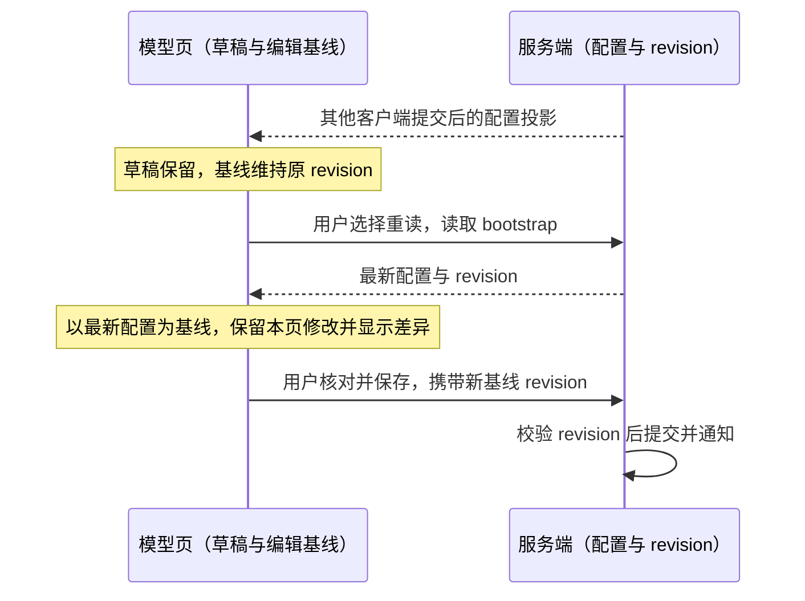

# 工具、输入辅助与设置

## 设置结构与布局

`SettingsPageFrame` 装配电脑浏览器全页设置覆盖层，复用搜索和基础控件，不包含原生窗口控制。侧栏宽 256px，与工作台对齐；顶部返回与底部齿轮均经同一门禁返回工作区。

一级导航为外观、项目配置、AI 配置和文档格式。AI 配置内使用手动激活的「AI 模型」「Agent 指令」页签。

普通设置入口打开后焦点进入顶部“返回工作区”按钮；显式项目配置请求沿现有定位规则聚焦目标项目。成功退出并解除工作区 inert 后恢复到实际打开入口，入口已卸载时回到工作区设置按钮。焦点由 Shell 保存入口、设置页负责进入位置，不改变导航或草稿 owner。底部齿轮仅为返回操作，不声明 aria-current；只有当前设置分区声明当前位置。项目配置的项目标题、外观的一级分组使用 h2，项目 Release 分组和代码预览使用所属分组内 h3，标题不得跳级。验收检查键盘打开／退出、配置入口往返和标题树。顶部返回按钮已有可见文字，程序化聚焦不弹重复 tooltip；底部图标-only 齿轮保留提示。

Shell 持有设置开关及已接纳分区。普通齿轮恢复最后接纳分区，项目配置请求明确进入项目，输入器模型入口明确进入模型。原生偏好映射为 appearance／general／modelProvider／personalization／agentBehavior；旧 skill 和未知偏好回项目配置。门禁接纳后才更新偏好，挂载、取消及保存失败不改记忆。

正文与主页共用所属面板内居中的 `max-w-4xl px-4 lg:px-8`、外观标题角色和顶部基线，正文滚动面使用稳定双侧滚动槽，长表局部横滚。项目配置的 Release 明细默认折叠，数量及添加操作始终保留；项目列表提供项目名称与仓库搜索，过滤不改变当前项目，无匹配显示提示。重复配置说明进入 disclosure，错误和未保存状态保持可见。

## 唯一离开门禁

主页面、对象、范围及浏览器历史归 `AIReqContext`。设置表单只注册保存／丢弃动作，设置页持有一个 pending 导航；分区切换、AI Tab、搜索、返回、齿轮及 Ctrl／Cmd+S 共用最新草稿、保存路径和同步忙锁。

全部相关草稿保存成功后只消费一次 pending；失败或取消保留原页与输入，丢弃只结清对应未保存修改。在途写入不能并发丢弃和卸载。存在草稿时浏览器关闭触发原生离开提醒，弹窗关闭恢复实际入口或原输入焦点。

丢弃类确认弹窗中，安全动作（继续编辑／取消）保持默认焦点；丢弃／放弃动作统一使用 destructive 变体，明确其破坏性后果，不使用默认主按钮填色。

Agent 指令与文档格式页脚的「放弃全部草稿」只处理当前分区的本地草稿。两处复用确认交互，说明将还原哪些编辑。安全动作或 Esc 保留草稿并回到实际触发按钮；确认放弃才在当前分区恢复已保存值，焦点回到正文内可继续操作的位置，不触发保存或导航。确认打开时，保存快捷键不提交表单。

覆盖层打开时，原工作区、会话及右侧 Tab 保持挂载但隐藏且 inert，正文、附件和未发送输入保留。返回不修改 mainView、对象、范围或 history，不发送消息或创建会话。

搜索仅列当前分区及保留的外观／业务设置项，复用中文、拼音模糊匹配及键盘交互。选择结果先结束搜索焦点锁，再经门禁接纳分区及定位目标，最后滚动、聚焦并短暂高亮已挂载行。普通分区切换清空旧定位，取消保留原定位；不恢复裁撤页面。

## 配置与保存

### 外观

代码样式的浅／深主题选择器后紧接两种主题的实时预览，行号、换行和字号控件紧随预览。默认桌面首屏在同一视野内看到主题选择器和预览样例，切换阅读选项即时更新样例。

浅色和深色槽分别决定对应界面下使用哪个代码主题，两槽均可选择 GitHub Light 或 GitHub Dark。代码内容区的语法文字、行号及底色随选中的代码主题配对，预览标题与「当前生效」仍按所属界面槽显示。预览与实际文档／会话的代码阅读器共用明暗配对；代码主题与界面同色系时保留原阅读表面，跨色系时内容区使用对应的浅／深底色，外层卡片与工具栏沿用界面配色。验收在宽／窄电脑浏览器分别选择两种交叉组合，检查代码文字达到 4.5:1，并核对当前生效标签和代码块之外的界面仍按原界面主题显示。

主题、界面字号及代码阅读设置由 `StoreProvider` 的现有 ZCode store 持有。可选动效、浅色、深色与跟随系统，控件使用现有国际化标题提供可访问名称。每次打开或刷新页面，首屏使用动效主题。用户选择即时应用，只在当前页面内保留。系统减少动态效果或已有性能模式开启时，主题配色保留，动画按[动效主题规则](../../../DESIGN.md#默认动效主题)停用。

重连替换 services 时保留 store、选择及未发送草稿，释放旧广播监听后绑定当前连接；入站更新沿 applyingBroadcast 防回环。离线选择仍应用本地 DOM 和偏好，广播失败记录可恢复诊断，不声称同步成功；重连不重放离线变更。Provider 卸载释放广播和系统主题监听。

### 项目配置

项目卡以紧凑摘要呈现名称、可选择的项目地址、默认分支及工作目录；宽度不足时元数据自然换行。折叠时仍可逐项比较配置、查看 Release 数量、编辑项目或添加 Release；展开后可读完整明细。

项目名称、项目地址、默认分支、工作目录及 Release 通过现有配置服务读取和保存。工作目录为服务端可写的绝对路径，每个项目独占。保存项目时，原型校验仓库地址和分支的格式，创建 `<工作目录>/docs/areq` 并发布当前材料，再公开新配置。正式服务的代码目录为 `<工作目录>/code/<项目名称>`，由代码准备过程管理。项目共享文档目录被占用时保留原内容并报告保存失败。修改工作目录后，开发者通过新地址重建链接。Release 仅用于归集需求。新项目默认分支预填 `main`；添加／编辑项目与添加 Release 标注必填字段，字段错误显示在对应输入下方并绑定 `aria-invalid`／`aria-describedby`。提交时文本控件保持挂载且只读，保存、取消及归属选择禁用；失败恢复编辑并保留原值。Release 数量只在同来源快照读取成功后显示，读取中和失败不显示伪造的 0。

项目配置页持有各表单的返回焦点。添加项目、编辑项目或添加 Release 的弹窗关闭后，若仍在本分区，焦点回到对应的打开按钮；按钮已移除则回到项目搜索框。取消丢弃确认时继续编辑并恢复原表单焦点。项目表单校验失败聚焦首个无效字段；提交 Release 时焦点保留在名称输入，同名校验失败后可直接修改。清除项目筛选聚焦搜索框。验收在 1100×700 键盘操作上述路径，检查每次关闭、丢弃或失败后的可见焦点。

### Agent 角色

AI 配置中的模型和指令页签使用同一份角色清单。

| 角色 | 职责 |
| --- | --- |
| 需求 Agent | 整理、生成和修改需求文档 |
| 需求评审 Agent | 受邀独立评审最新需求文档并返回意见 |
| 方案 Agent | 生成和修改方案、SR 材料及依赖 |
| 方案评审 Agent | 受邀独立审查方案、规格、任务、依赖与测试材料 |

### AI 模型与生效范围

所有项目和 Release 共用工作流默认模型和各 Agent 的模型、思考强度与追加指令。模型选项「跟随默认」使用工作流默认模型，思考强度选项「模型默认」使用模型预设。

工作流在新建讨论会话或接纳评审时读取并绑定当时的模型、思考强度及追加指令。已有讨论会话、已接纳的评审及历史报告保留各自的配置快照。页面顶部说明共享范围及生效时间。

默认模型旁显示当前已保存的跟随角色数量与名称，没有跟随角色时明确显示 0；草稿改变跟随范围时另列保存后的跟随角色。临近选择器显示其用于新建讨论和新接纳评审，已绑定配置保留。AI 配置页签提供 h2 页标题供屏幕阅读器读取，「工作流默认模型」控件使用同名可访问名称并关联当前范围。

已保存配置和 revision 由服务端持有，通过现有 bootstrap 读取。模型页持有草稿及首次编辑基线，未保存摘要由字段差异派生。后台通知只更新最新配置投影。已发现 revision 不匹配或保存失败时，保留草稿，并在保存区提供「重新读取模型配置」；保存键和离开门禁同时提示重读，重读失败可重试。重读成功后，用最新配置更新基线，仅保留原草稿实际修改的默认模型、各角色模型或思考强度字段，未修改字段采用最新值。页面并列显示剩余修改的最新已保存值和本页草稿；用户核对后再次保存才会写入。保存继续携带预期 revision，同步忙锁防止重读、写入与离开并发。

验收使用两个客户端：默认四角色均固定模型时显示 0；更改跟随角色可同时识别已保存和草稿的不同作用范围。甲修改默认模型，乙先保存另一角色的思考强度；甲的草稿保留并等待重读，重读带入乙的值并显示甲的差异，甲再次保存后同时保留两处改动。同一字段两端都改动时，重读后显示双方各自的值。

### Agent 指令

按 Agent 在内建指令后追加团队指令，空值表示只使用内建指令。UTF-8 字节计数和超限使用共享 `USER_INSTRUCTIONS_MAX_BYTES`。切换 Agent 保留全部草稿和未保存标记，保存或确认放弃作用于所有 Agent。任一超限或 revision 冲突保留输入，快捷键使用同一校验。追加指令按[统一生效规则](#ai-模型与生效范围)用于各角色的新会话和评审。默认选中 Agent 列表第一项，列表为空显示空态。

超长指令在编辑区内滚动。指令表单从本地草稿派生 UTF-8 超量，字段错误关联到当前编辑器，吸底操作区和离开确认均列出超限 Agent 及精确字节数。表单提供定位至第一个超限 Agent 编辑器的动作；离开确认的继续编辑保留全部草稿。表单和离开确认均禁止保存超限内容，以服务端相同的字节限制为准。1100 × 700 下输入 102,402 字节，应能在正文操作区与离开确认中读到「超出 2 字节」；缩短至 102,400 字节后可保存。

模型与指令复用 `SettingsFormActions`：提交区位于字段之后，实心保存、ghost 次操作，保存中禁用。有未保存草稿时提交区贴住正文可视区底部，同处显示从草稿派生的修改摘要。滚动到最后一个字段仍能看到摘要及操作。指令通过页脚确认恢复全部草稿；模型取消恢复本页模型草稿。成功使用 status 与辅助色，失败使用 alert、错误色及“保存失败”前缀，修改或放弃清除旧反馈。共享范围和生效说明精简呈现，完整解释放入现有可展开说明。

## 文档格式

「文档格式」是独立的一级设置。每种文件可添加、修改和移除必需章节，列表初始为空。固定清单按 IR 与 SR 分组，路径以工作树根目录为基准：

| 对象 | 文件路径 |
| --- | --- |
| IR | `docs/requirements/<ir-id>/requirements.md` |
| SR | `openspec/changes/<sr-id>/proposal.md` |
| SR | `openspec/changes/<sr-id>/design.md` |
| SR | `openspec/changes/<sr-id>/tasks.md` |
| SR | `openspec/changes/<sr-id>/test-plan.md` |
| SR | `openspec/changes/<sr-id>/specs/<sr-id>/spec.md` |

`docs/requirements/<ir-id>/sr-dependencies.json` 也参与定版检查，但不是可设置 Markdown 章节的文件。

所有项目和 Release 共用一套已保存的章节规则。草稿沿用设置页的保存、确认放弃和离开门禁，保存成功后供后续编写和格式提示使用。定版提交预检快照，服务端确认版本及文件仍一致后按当时已保存的格式规则复核。

每行只填写完整章节标题文字。例如 Markdown 中的 `## 范围` 填 `范围`。定版检查按标题精确匹配，并要求该章节有非空正文；留空时只检查文件。表单从本次编辑的规则文本派生校验错误，带 Markdown 标题标记（行首 `#` 标记或标题下划线）的行须先修正才能保存。错误标明文件内行号并关联字段，页脚保存、快捷键和离开时保存共用校验。未编辑文件的规则原样保留。

验收检查一级入口、固定的六种文件和初始空清单。粘贴 `## 范围` 时显示行内错误并阻止保存，改为 `范围` 后可保存且不改变其他文件规则。在 1100×700 使用 Tab 和 Shift+Tab 经过各文件输入框，聚焦字段保持可见，底栏仍可操作。

## 原生输入与 Sketch

可编辑业务会话复用原 composer 和附件事务，不复制输入器或草稿 owner。模型和思考档位显示创建时的会话绑定，输入不覆盖绑定；在设置中修改角色配置只影响随后创建的讨论会话和随后接纳的评审。

Sketch 使用浏览器真实 Canvas，位于全页 Dialog 内的现有 HTML iframe，通过既有路径复制主题及字号变量。保留画笔、橡皮、颜色、粗细、绘制、平移、缩放、适应、撤销、清空和尺寸调整。色块未选中也有可见边界，颜色与粗细以 `aria-pressed` 表达状态。启用并聚焦「平移」时，用方向键移动视野，不改变画布内容；尺寸手柄接受键盘焦点时移入视野，后续方向键调整尺寸时保持可见并沿用像素保留规则，不误触添加附件。

“添加附件”生成完整画布 PNG，经原 `onAddFiles` 加入当前 composer，绝不自动发送。父页只接纳当前 iframe 的同源消息并校验 PNG 签名；原附件数量和输入状态门禁继续有效。失败向画布反馈原因并保留绘制，成功接纳才关闭。取消按钮与 Esc 都由 iframe 按当前画布相对初始画布的改动决定是否确认。未改动时直接关闭；有改动时默认聚焦「继续绘图」，继续或再次按 Esc 保留画面及视野并恢复画图焦点，明确选择「放弃绘图」才关闭。父层收到 Esc 时将取消意图转给当前 iframe；关闭不改原草稿并恢复 composer 焦点。主动作使用 primary／primary-foreground 配对色，绘图本身颜色不随界面主题改写。

桌面验收覆盖 1100×700 和 1440×900。绘制后用 Esc 或取消打开确认，继续后笔迹及缩放保持，放弃后重新打开为空白。放大后以平移方向键查看边缘，Tab 聚焦尺寸手柄后可直接调整宽高，手柄不被裁切。

语音输入沿现有弹层确认可编辑文字后追加原草稿，取消不改输入；具体服务能力见 [内存后端](../../architecture/mock-backend.md)，不能从录音样式推断真实音频服务。

## 当前私有 Skill 实现

以下记录现有的私有实现。组件保留原生会话、composer、可调分栏、表单及临时文件预览。设计会话按工号、client、项目绑定，无项目使用明确个人范围。

说明表单只保存可编辑的 goal／when／inputs／outputs、boundaries／references／example，字段可空，按原序列保存。对话补充 notes 由服务端在会话完成时追加，表单只读展示；保存表单和提交补充各自只更新所属字段。准备对话先等说明保存成功，再提交可编辑字段，由服务端补入当前会话已提交的备注，生成完整说明并插入原 composer。requestId／ACK 只确认实际应用，8 秒未 ACK 显示可重试错误；保留人工正文、附件和模型，不自动发送或因回填生成文件。再次准备仅替换完整未改片段，否则追加。

对话／文件 Tabs 保留挂载、草稿和分栏，隐藏时 inert。预览按当前 revision 选择有效文件，frontmatter 与正文分开，原始元数据和非 Markdown 使用同一代码字号、主题、行号及换行设置。

技能配套流程图作为普通预览文件参与同一 revision、逐文件确认与原子保存；不因准备说明而自动生成或保存。原型服务可在内部模拟生成无脚本、无外部资源引用的 SVG 流程说明，并在主文件中引用，不将模拟产物表述为真实 AI 执行证据。保存后的 SVG 与主文件共用 Skill 文件 owner；媒体读取从该 owner 返回实际已保存的原始 UTF-8 字节和 `image/svg+xml`，不把附件 ref 当作文件路径，不另外复制媒体存储或写宿主业务文件。

媒体 MIME 由文件实际内容识别，不能只按扩展名返回类型或伪造字节。媒体读取返回完整内容；缺失、目录或无法识别的媒体内容明确失败。stat、分片与媒体共用同一文件节点的原始字节；内存二进制节点不经 UTF-8 解码再编码。

保存要求有效目标、当前预览的候选名称合法且在目标中无同名冲突，并逐一实际预览当前 revision 全部文件。新 revision 清空旧资格；保存前同步单飞锁拒绝重复激活，operationId 由原 owner 幂等裁决。全部文件原子接纳后才显示 path／revision 收据，失败不显示已保存。项目与共享目标分别查重，不提供重命名覆盖旁路，旧响应不能确认新版文件。

说明待结清和未确认预览共同注册原门禁，不能以说明保存绕过预览资格。“保存并离开”不可用时明确原因；失败后允许显式丢弃本版确认保存，但不删除临时预览、会话、未发送正文或附件。新 revision 再次要求确认。

## 实现依据

- `packages/ui/src/aireq/shell/AIReqShell.tsx`
- `packages/ui/src/aireq/settings/AIReqSettingsPage.tsx`、`AIReqProjectSettings.tsx`、`AIReqAgentModelSettings.tsx`、`AIReqPersonalizationSettings.tsx`、`AIReqDocumentFormatSettings.tsx`
- 固定路径模板见 [`document-formats.ts`](../../../packages/services/src/aireq/document-formats.ts)，服务端定版检查见 [`document-validation.ts`](../../../packages/server/src/aireq/document-validation.ts)。
- `packages/ui/src/aireq/tools/AIReqSketchButton.tsx`、`sketch.html`、`AIReqSkillDesignPage.tsx`、`AIReqSkillFilePreview.tsx`
- `packages/ui/src/store/StoreProvider.tsx`

公开接口不会因隐藏组件或通用控件存留而扩展；部署和真实服务能力边界集中见 [内存后端](../../architecture/mock-backend.md)。
