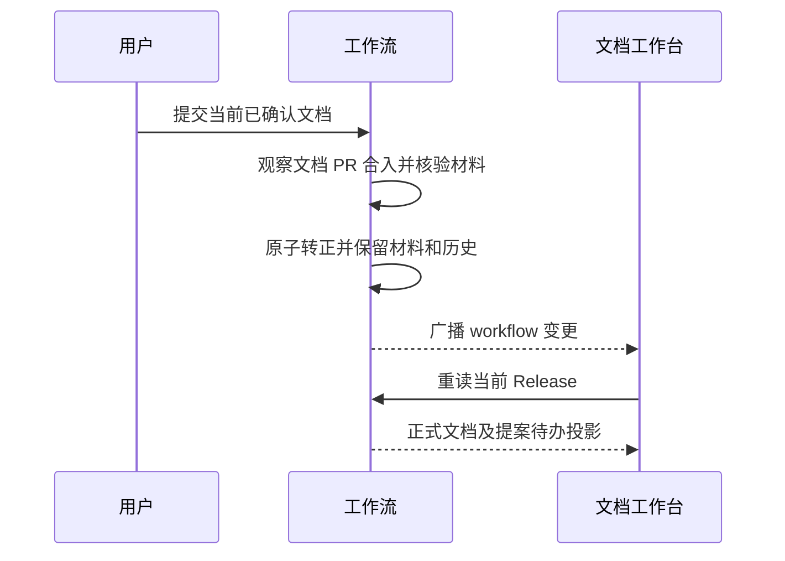
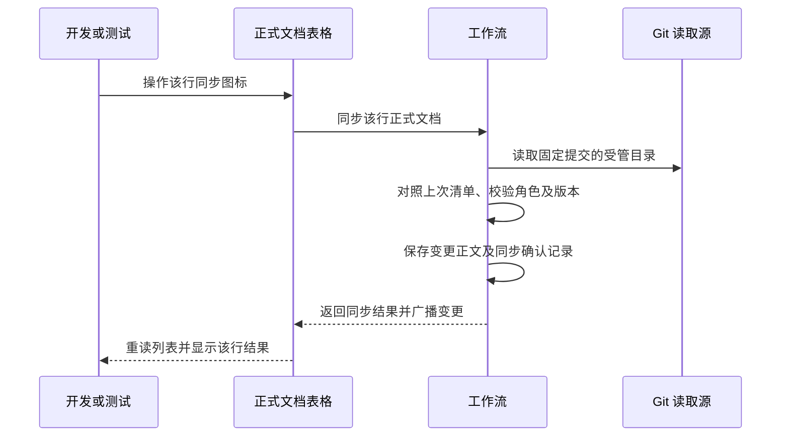
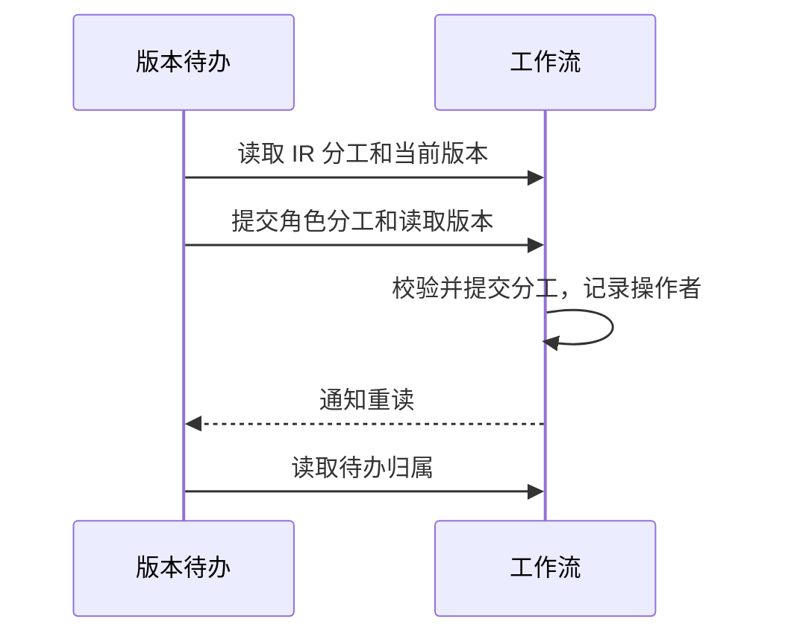

# 正式文档与版本待办

## 正式文档

文档 PR 已合入且工作流核验其候选、版本及完整材料后，原 IR 转正并进入所属项目与 Release 的「正式文档」。同一 IR 保留原始需求、SR 规格、文档合入事实、材料与讨论评审历史。SR 是正式需求的规格拆分。合入是平台流程终点。

发布时冻结 MR 所属仓库标识、地址和目标分支。核验时若项目 Git 目标已变化，不将旧 MR 转正或写入新仓库，旧 MR 仍可按原目标处理。

列表按当前项目与具体 Release 读取正式 IR，每个 IR 一行，依次显示「文档名称」「业务」「开发」「测试」，有同步权限时在最右侧显示「同步」列。名称下显示一行原始需求摘要，与标题相同时省略；搜索匹配完整名称和原始需求。参与人工号从该 IR 转正时的评审与确认记录派生。业务取 IR 需求评审确认人，开发取生效方案审查的发起人，测试取同一方案审查和材料快照的测试方确认人。缺失工号的历史记录显示「—」。Git 同步只更新正式材料，归档参与人沿用转正记录。默认按合入核验时间从新到旧排列，缺失时间的记录排在末尾，时间相同按名称排列。

除同步图标外，点击文档行进入正式详情，键盘可通过文档标题进入。详情显示材料核验完成及归档日期，提供只读交付记录（PR 标识、合入与核验结果及文件清单）以及可用的外部 PR 链接。原始需求与标题相同时不重复正文；长标题默认两行并可展开。历史按需求和方案分组，标明轮次，选中后以当前会话标题引导阅读。评审历史分别展示执行、人工决定和退回／失效状态，方案审查按所属轮次显示三方确认记录。显式 IR／SR 链接定位所属文档及材料。已有正式记录沿用同一阅读入口；允许由正式文档创建关联新提案，表单显示来源文档标题和版本。材料与历史均只读，阅读沿用[右侧工作区](unified-side-pane.md)。

工作流唯一持有交付与归档事实。服务使用既有 `readWorkflow` 返回正式文档、参与人、材料与按版本聚合的提案／文档数量；待办只从未转正提案派生。发布接口只处理文档交付。转正事务不创建 SR 开发分支，不产生开发、排期、进度分析、代码合入或测试验收记录。

验收覆盖待合入时仍在需求共创、合入核验通过后进入正式文档、桌面表格列顺序与核验时间排序、实际参与人工号及历史缺失值、点击行与键盘通过标题打开详情、按完整原文搜索、原文与材料可读、历史可查、旧 IR／SR 链接可定位、版本切换及无 Release 空态。发布及转正前后均不提供开发跟踪和进度分析入口。

### Git 同步与文件版本

正式文档表格对管理员及当前项目已授权的开发和测试提供行末「从 Git 同步」图标。鼠标点击和键盘激活均对该行归档文档执行 `syncFormalDocuments`，并停留在列表。同步期间禁用同步操作，成功结果显示在对应文档名称下，失败沿用工作区错误提示。同步入口仅在列表提供。服务端只从配置仓库及分支读取同一个不可变提交内的受管文档。首轮以已归档清单校验，之后以最新接纳的文档清单校验。比较完整相对路径集合，缺少、新增、移动或改名都整批拒绝并列出差异。受管目录以外的仓库文件不纳入比较。

提交时再检查平台的目标、清单、版本及操作者权限。仅变更文件写入新版本，成功同步即已确认。每份变更文件记录 Git 提交号、说明、提交人、提交时间，以及同步人和同步时间。未变化的文件沿用现有版本。相同内容不建立额外版本。初次合入与历史人工确认保持原始关联。

工作流持有平台文档、快照和操作记录。正式部署从可信 Git 读取源取得提交。默认模拟服务以独立的内存仓库分支快照提供同一读取契约。平台同步不改动该快照，模拟文档 PR 合入时更新对应分支。

验收覆盖有权限时可通过最右列图标同步指定文档并留在列表、同步成功或失败的反馈、无权限时隐藏同步列，以及正式详情中没有同步入口。

## 版本待办

待办由尚未转正的提案事实派生。服务端按当前工号具备的项目角色返回可处理事项，再由页面按当前项目与具体 Release 过滤。默认打开「我的」，只显示归属工号与当前工号相同的事项。「待认领」只显示没有归属工号的事项，「全部待办」显示同范围可处理事项。各筛选数量与列表使用同一范围。

| 需人工处理的事实                       | 处理角色             |
| -------------------------------------- | -------------------- |
| 澄清、补充业务需求及提交或确认需求评审 | 业务                 |
| 方案设计、材料补充或提交方案审查       | 开发                 |
| 方案三方确认                           | 待确认的对应角色     |
| 提交正式文档 PR                        | 开发                 |
| 评审失败或文档交付失败                 | 对应阶段的处理角色   |

待办显示处理角色及明确的归属标签。当前工号的事项显示「我的」和工号，已分配给其他工号的事项显示「他人」和工号，无工号的事项显示「待认领」。窄桌面将同一信息并入事项正文，打开事项的按钮名称也包含归属。新提案的业务待办默认归属提案提交人。认领或调整分工只在版本待办提供，写入对应 IR 角色的分工。行内菜单对待认领事项提供「由我认领」，对他人的事项提供「由我接手」。工作流持有分工事实，使用现有 `readWorkflow` 读取最新工号和版本，`assignContacts` 校验版本后提交分工、记录操作者并通知重读。分工用于待办归属，处理权限按项目角色校验，正式文档的参与人取归档记录。

进入待办定位对应提案与阶段。完成业务动作后事项自然移除，操作按实际工号留痕。正式文档不产生新的待办。

验收覆盖两位工号在打开同一事项前看到各自的「我的」或「他人」、未分配事项进入「待认领」、认领后各工号同步更新、切换 Release 回到「我的」、窄桌面可查看归属及打开分工。
