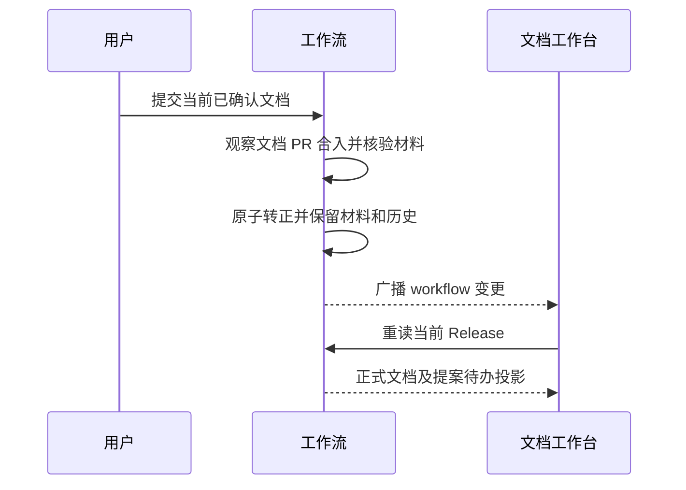
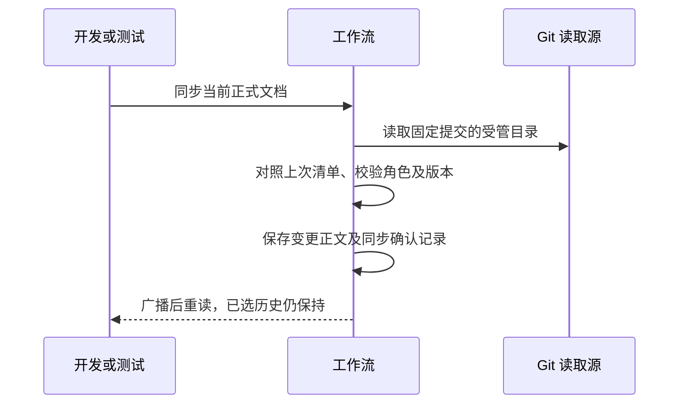

# 正式文档与版本待办

## 正式文档

文档 PR 已合入且工作流核验其候选、版本及完整材料后，原 IR 转正并进入所属项目与 Release 的「正式文档」。同一 IR 保留原始需求、SR 规格、文档合入事实、材料与讨论评审历史。SR 是正式需求的规格拆分。合入是平台流程终点。

发布时冻结 MR 所属仓库标识、地址和目标分支。核验时若项目 Git 目标已变化，不将旧 MR 转正或写入新仓库，旧 MR 仍可按原目标处理。

列表按当前项目与具体 Release 读取正式 IR，支持按名称和原始需求搜索。点击文档标题进入正式详情，可直接阅读材料、查阅讨论与评审历史，以及打开已合入的文档 PR（有地址时）。显式 IR／SR 链接定位所属文档及材料。已有正式记录沿用同一阅读入口；允许由正式文档创建关联新提案。材料与历史均只读，阅读沿用[右侧工作区](unified-side-pane.md)。

工作流唯一持有交付与归档事实。服务使用既有 `readWorkflow` 返回正式文档、材料与按版本聚合的提案／文档数量；待办只从未转正提案派生。发布接口只处理文档交付。转正事务不创建 SR 开发分支，不产生开发、排期、进度分析、代码合入或测试验收记录。

验收覆盖待合入时仍在需求共创、合入核验通过后进入正式文档、原文与材料可读、历史可查、旧 IR／SR 链接可定位、版本切换及无 Release 空态。发布及转正前后均不提供开发跟踪和进度分析入口。

### Git 同步与文件版本

正式文档页对管理员及当前项目已授权的开发和测试提供「从 Git 同步」。服务端只从配置仓库及分支读取同一个不可变提交内的受管文档。首轮以已归档清单校验，之后以最新接纳的文档清单校验。比较完整相对路径集合，缺少、新增、移动或改名都整批拒绝并列出差异。受管目录以外的仓库文件不纳入比较。

提交时再检查平台的目标、清单、版本及操作者权限。仅变更文件写入新版本，成功同步即已确认。每份变更文件记录 Git 提交号、说明、提交人、提交时间，以及同步人和同步时间。未变化的文件沿用现有版本。相同内容不建立额外版本。初次合入与历史人工确认保持原始关联。

工作流持有平台文档、快照和操作记录。正式部署从可信 Git 读取源取得提交。默认模拟服务以独立的内存仓库分支快照提供同一读取契约。平台同步不改动该快照，模拟文档 PR 合入时更新对应分支。

## 版本待办

待办由尚未转正的提案事实派生。页面按当前项目和具体 Release 过滤，「我的」「待认领」「全部待办」的数量及列表使用同一范围。切换项目或 Release 后默认回到「我的」。

| 需人工处理的事实                       | 归属                 |
| -------------------------------------- | -------------------- |
| 澄清、补充业务需求及提交或确认需求评审 | IR 业务联系人        |
| 方案设计、材料补充或提交方案审查       | IR 开发联系人        |
| 方案三方确认                           | 对应角色的 IR 联系人 |
| 提交正式文档 PR                        | IR 开发联系人        |
| 评审失败或文档交付失败                 | 对应阶段的 IR 联系人 |

没有联系人时可认领，也可以显式调整分工。代办记录实际操作者。进入待办定位对应提案与阶段；完成业务动作后自然移除。正式文档不产生新的待办。待办页和分工弹窗展示需求名称、角色和工号；窄桌面将归属并入事项摘要，保留分工操作。
