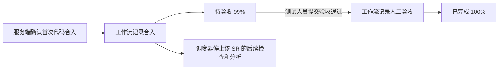

# 正式需求、进度分析与人工待办

本文定义正式 SR 的产品要求。当前模拟后端的分析和验收实现见[后端契约](../../../packages/server/src/aireq/CONTRACT.md#业务所有权)。

## 开发任务与报告

开发任务使用左侧当前项目与具体 Release，以正式 IR 为主行，展开所属 SR。IR 展示原始需求、状态、进度及人员计划汇总；SR 展示开发／测试负责人、有效进度、问题、计划与登记分支。名称与层级遵循[主页面对象标识展示](section-navigation-and-ideas.md#主页面对象标识展示)，列表不显示内部 IR／SR ID。搜索、状态筛选不改变进度计算的全量范围。

IR 报告汇总全部所属 SR，SR 报告只读自身事实。材料、进度报告、历史及分析执行报告进入[统一右侧多 Tab](unified-side-pane.md)，不使用旧分析报告 Dialog。Tab 自带对象和执行 ID，不随主区选中行替换目标。报告先展示状态、问题与当前动作，再展示计划和代码证据。

正式对象不挂开发聊天或编码执行。当前 SR 分支只取登记映射；缺失、创建失败和已清理分别显示，不用旧报告或猜测名称兜底。分支复制不调用 Git。

主区容器（`@container/conversation`）宽度不足 640px 时开发任务表进入紧凑呈现：负责人及计划列折叠为行内展开详情（IR／SR 行各自独立，按钮带 `aria-expanded`），展开行以跨列详情行呈现完整人员与计划，详情行随名称列固定，横向滚动不遮住人员与计划；名称列保留负责人摘要（开发／测试工号或待认领），摘要分行呈现开发与测试负责人，不省略测试负责人，状态、进度、关注项与操作列不变，表格最小宽度降为 480px。宽面板恢复完整列，不缩小字号。搜索框提示与无障碍名称同时覆盖 IR 与 SR 名称。

开发任务与我的待办的行内操作入口在行悬停、行内键盘聚焦或菜单展开时显现。进度分析任务行的“详情”和执行历史行的“报告”始终可见，键盘与指针打开同一入口。开发任务的局部横向滚动只在确有可揭示列时显示提示与左右按钮，不保留可点但无法移动的控件。

## 人工分工与计划

IR 保存业务、开发、测试联系人；SR 初始继承 IR 开发／测试联系人，之后可独立指定、认领或清空。显式清空表示待认领，不回退为 IR 联系人。负责人、实际操作者和修改来源分别保存，同人可兼任，合法工号可代办，不建立负责人专属授权。

SR 开始、结束按项目时区表达，必须同时填或同时清空，结束严格晚于开始；保留原建议、假设、人工修改来源与时间。IR 取所属 SR 最早开始和最晚结束，缺项标不完整；提案预估不自动换算日期。依赖先后、前置未排期、同人时间重叠只作协调提醒，不自动移动其他 SR。

开发任务表以中性文字表示 SR 自身未排期或 IR 含未排期的 SR，包括已完成任务。仅在已有完整计划的 SR 存在依赖或人员协调提醒时，对该 SR 及所属 IR 显示警示图标与对应读屏提示；展开的人员与计划详情沿用相同规则。

编辑绑定开始时版本，后台重读不覆盖草稿。在途保存禁止重复提交、关闭与修改；失败保留输入，离开经过保存、丢弃或继续编辑门禁。

## SR 状态与有效进度

| SR 状态 | 判断条件                                             | 有效进度          |
| ------- | ---------------------------------------------------- | ----------------- |
| 待开发  | 代码未合入且有效进度为 0                             | 0%                |
| 开发中  | 代码未合入且有效进度大于 0，分析尚未明确判定为待合入 | 大于 0%，最高 99% |
| 待合入  | 代码未合入且有效进度大于 0，分析明确判定为待合入     | 大于 0%，最高 99% |
| 待验收  | 已记录首次代码合入，等待人工验收通过                 | 99%               |
| 已完成  | 测试人员已提交验收通过                               | 100%              |

首次合入前，有效进度取分析估计，限制在 0–99%，可随证据下降。没有分析时按 0% 计并标明未分析。分析失败时保留上次成功报告和进度，标明失败或过期。首次合入后，有效进度以合入和人工验收事实为准，原始分析评分仍可查阅。

IR 等权平均全部所属 SR。项目及逐 Release 汇总直接平均范围内所有正式 SR，不能先平均 IR；提案不进分母，未分析正式 SR 按零计。无正式 SR 时进度为 `null` 并显示空态，非全部完成最多显示 99.9%，新增正式 SR 可以降低聚合值。

IR 全部 SR 完成才完成。计划、分工及文档 PR 合入本身不增加开发进度。

## 首次代码合入与人工验收

首次代码合入以工作流记录的默认分支合入事实为准。记录合入后，SR 进入待验收，同时退出后续自动检查和手动进度分析。开发任务保留已登记的分支及首次合入证据，历史分析报告仍可查阅。Git 观测由服务端负责，内存模拟和外部能力边界见[后端运行说明](../../architecture/mock-backend.md)。

待验收的 SR 只提供「验收通过」。测试人员发现问题时，SR 继续处于待验收并保持 99%。测试人员确认通过后提交验收依据。工作流校验正式 SR 归属、预期修订和已登记的合入版本，保存验收依据、操作者、时间和版本，再将 SR 计为已完成、100%。首次合入记录足以进入验收，无需成功的分析报告。验收由测试人员决定，后续修复及 Issue 跟踪在本流程范围之外。

报告展示已保存的分析问题和验收记录，IR 汇总所属 SR。未分析、报告过期及分析失败分别说明；部分 SR 已有报告时，其余 SR 仍保留各自的分析状态。

验收覆盖以下场景。

- SR 首次代码合入后显示待验收、99%，并从自动检查、手动批量分析和单项重试的可执行范围移除。其他尚未合入的 SR 仍按各自条件参加分析。
- 分析运行期间发生首次合入时，迟到结果仅进入历史，SR 保持待验收和 99%。
- 待验收期间，即使测试发现问题或外部修复合入，SR 仍保持待验收、99%。测试待办持续可见。
- 测试人员提交验收通过后，SR 变为已完成、100%，测试待办消失。重复请求不复制验收记录。

## 统一进度分析

分析页仅在项目和具体 Release 均已确定后读取任务与执行历史、发起手动分析。项目缺少 Release 时显示统一的[配置空态](section-navigation-and-ideas.md#页面与正文)；从已有 Release 切入该空态时，清除旧范围的筛选结果和分析确认。配置并选定 Release 后读取该版本。

分析与开发任务共用当前项目和具体 Release，提供任务、执行历史、搜索与需求筛选。每个项目／IR／SR 唯一建档；执行历史保存触发方式、时间、分支、输入版本、模型／指令快照、结果与前后进度。分析页的需求筛选、任务详情、执行报告、确认范围及失败操作使用项目、需求与 SR 名称，不显示内部 projectId／irId／srId；需求筛选浮层限制在内容列内，长名称截断并保留完整提示。已加载结果有匹配任务但 `eligibleCount` 为零时，按钮位置提示当前没有可发起分析的 SR。没有匹配任务时由结果区说明当前范围为空或没有符合筛选条件的 SR。项目分析关闭时显示关闭状态。这三种情况都隐藏“分析 0 个 SR”，仅凭资格计数不推断任务已完成或停止。验收覆盖筛选零匹配及匹配任务存在但不可再次发起两种情况。执行历史的时间范围错误保留结果框架，错误绑定结束时间输入；历史行显示父需求名称。

任务列表以项目、Release、需求及搜索范围为基础。服务端在分页前统计该范围内的失败任务数，再应用可选任务状态筛选，返回匹配总数、可发起分析数及当前页。任务首页提供带数量的“失败”快捷筛选，与状态选择器共用一个筛选值；再次点击恢复全部状态。任务状态仅作用于任务列表及其批量分析，切换到执行历史保留独立的历史结果状态筛选。空匹配可清除筛选。验收覆盖跨分页的失败总数、失败与搜索／需求的组合、清除筛选及批量确认数量与所选范围一致。

全局开关、检查间隔与项目开关集中在 AI 配置 → 分析设置。间隔为正安全整数分钟，新项目默认关闭。全局关闭只停自动接纳；项目关闭同时排除手动。关闭不取消已接纳任务、不删历史。

自动分析只接纳项目开启、到期、代码尚未合入且未运行的任务。后台按实际经过时间检查，不依赖页面打开，不为每 SR 建独立计时器。手动分析先确认冻结的项目、Release、需求、搜索与任务状态范围，覆盖全部匹配分页；取消不提交，服务接纳时重核资格，同 SR 并发去重。首次合入后，该 SR 从手动分析候选和可发起数量中移除，单项发起入口关闭。

输入版本包含任务材料、代码／默认分支与合入事实。进度分析 Agent 的模型、思考强度和追加指令在接纳时按[AI 配置规则](tools-settings.md#ai-模型与生效范围)冻结。材料和代码未变时，分析可沿用去重规则。仅保存新的模型或指令不触发重分析；对于项目分析开启且尚未首次合入的 SR，若当前配置与上次采用的分析配置不同，用户可手动发起一次分析，即使材料和代码未变。手动结果记录实际使用的配置。

分析运行期间发生首次合入或业务输入变化时，历史保留未采用结果，正式进度继续按最新业务事实显示。修改配置不影响已接纳任务的执行快照。最新成功报告由正式表与分析页共用。验收覆盖只改模型、只改指令、没有实质配置变化及 SR 已合入四种情况，并核对手动分析历史的模型和指令快照。

任务与历史服务端分页，每页 25 或 50，筛选变化回第一页，数据减少调整到有效页。历史还支持状态和时间范围，完整报告按执行 ID 读取。失败报告给出阶段、原因、下一步和可重试性；单项重试须失败可重试、项目开启、任务存在且未运行、代码尚未合入，只作用于该项目／Release／IR／SR。

## 我的待办

待办由业务事实派生，不是 `tasks.md` 勾选项或分析任务，没有手工新建／勾选完成状态。页面严格过滤当前项目与具体 Release；“我的待办／待认领／全部待办”的数量与列表来自同一范围。标题旁以次级文字显示当前项目与 Release 名称，长名称截断并保留完整 title，范围切换即时更新。主区容器宽度不足 640px 时归属列并入待处理事项单元格次级行，需求和事项换行，取消表格最小宽度；筛选与分工操作不变，分工无需横向滚动。

分工弹窗只展示需求、开发单元、项目、分工类型与当前工号，不显示内部 IR／SR 编号；名称缺失时使用业务兜底而非 ID。新工号输入与格式说明关联，非法格式标记 `aria-invalid` 并就地提示；菜单与弹窗统一使用“分工”，不把联系人称为负责人。

| 需人工处理的事实                     | 归属                   |
| ------------------------------------ | ---------------------- |
| 提案待讨论、业务补充、需求评审待确认 | IR 业务联系人          |
| 方案设计或材料待补充                 | IR 开发联系人          |
| 方案三方待确认                       | 各视角联系人，分别确认 |
| 三方齐备待提交文档 PR                | IR 开发联系人          |
| 正式 SR 待开发                       | SR 开发负责人          |
| 正式 SR 待验收                       | SR 测试负责人          |
| 需要人工处理的运行或交付失败         | 对应阶段联系人         |

无归属进入待认领；认领与分配修改真实联系人或负责人，代办不暗改分工。进入处理定位需求及阶段，业务动作完成后待办自然消失。正常运行、等待文档合入或等待调度不制造无操作可做的待办。

## 完成维护与恢复

只有 IR 全部 SR 达到 100 才开放分支清理。预览只列该 IR 登记开发分支，不含主分支；确认绑定版本及分支集合。逐项保存成功／失败，重复请求只处理未成功项，失败保留清单供重试。清理不改进度，不删材料、报告、验收历史，不构成通用分支管理。

提交后工作流／调度事件通知重读。首次加载、错误与空数据分别呈现；后台更新保留列表、报告、筛选及滚动。迟到响应只作用于原查询或 Tab；刷新、断线和重连不重发验收、分配、清理或分析。

## 事实来源

`packages/services/src/aireq/` 下的 `progress.ts`、`planning.ts`、`progress-scheduler.ts`；`packages/server/src/aireq/` 下的同名实现；`packages/ui/src/aireq/AIReqTodoPage.tsx`、`side-pane/AIReqAnalysisReportTab.tsx` 与 `tracking/`。
