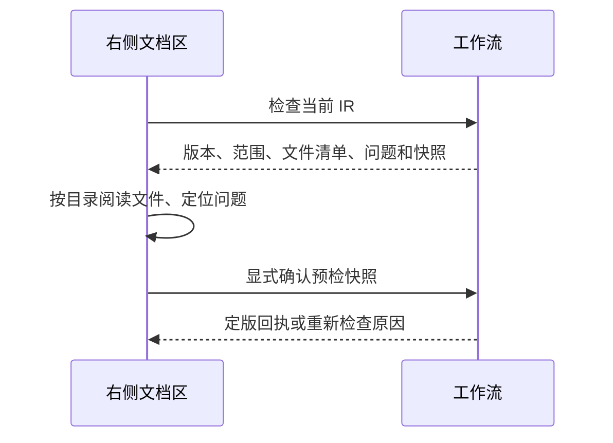

# 统一右侧文档区

## 入口与所有者

需求共创每行的「查看文档」在右侧展开对应需求的文档，保留列表位置。讨论已有文档时默认并排打开：需求 Agent 打开业务需求，方案 Agent 优先打开技术方案，再回退到其他 SR 方案文件或业务需求。暂无文档时默认使用整栏讨论，页头保留可展开的文档入口；首次保存材料后可自动并排展示，手动阅读或收起后保持用户的选择。文档区顶部提供收起入口，会话内收起后，消息到达或文件更新均保持收起。用户可通过会话页头重新展开。

工作台只有一组主区和右侧可调宽面板。文档区持有文档标签、激活项、顺序、折叠及完整视图。打开需求文档时创建标签，标签总览用于切换多个标签及恢复已关闭的文档。主导航由 AIReqContext 管理；工作流持有文档、版本和确认事实。多个标签以项目、Release 及需求对象定位，同一标签维持自己的阅读选择。

## 面板与桌面布局

- 顶栏横跨整个工作区，列表对照文档初始约七比五，会话对照文档初始各半。需求共创的页头与项目操作位于表格和文档的上方；需求列表或讨论与右侧文档等高，顶边、底边和圆角对齐，中间保留贯穿全高的 8px 可拖动间隙。底部留 8px，讨论分栏顶部也留 8px。文档标签栏底线随左侧筛选栏或讨论标题栏对齐，包括文字换行及调整分栏宽度时。拖动调整分栏时保持会话和文档挂载。
- 收起保持已有标签，主区填满剩余宽度。重新展开沿用激活标签。切换标签保持同一范围内的阅读状态。
- 切换项目与 Release 时切到目标范围的标签。切换工号时清除本次会话标签。不同范围的迟到请求不得改变当前面板。
- 云龙原文可从会话页头或右栏目录打开，标明来源，与正式材料独立；原文不计入定版文件。方案空态按当前会话引导起草设计和测试方案。
- 右侧面板可拖动调整宽度或切换完整视图。折叠和完整视图不重新挂载原生聊天会话。Esc 仅在文档区接纳焦点且上层弹窗或菜单已关闭时退出完整视图。
- 设置覆盖期间保留工作台及阅读状态，隐藏的文档操作不可交互。键盘可进入、切换和关闭标签。

## 文档与版本

「查看文档」默认打开同一需求的最新版本；需求列表的定版版本入口定位到指定快照。没有文件时显示明确空态。版本状态及版本菜单与需求共创列表统一使用「已定版」和「草稿」。文档统一通过目录切换，目录按 IR 与 SR 分组。顶部工具条可查看和复制当前文件路径。正文、技术路径和目录来自同一版本；读取失败显示原因并支持重读当前文件。最新版本继续更新时，原路径仍存在则保留当前文件选择。选择较早的定版时，目录和正文使用当时的快照。

项目开发或测试从最新版点击「检查定版条件」。右栏保留当前正文与滚动位置；顶部的文档目录标明当前文件及所属 SR，可继续切换阅读。右栏底部固定核对区显示 IR、需求或方案、版本及本次预检的文件数，可按 IR／SR 展开本次文件清单，选中文件后收起清单并将焦点移到正文。通过后默认聚焦「取消」，显式确认整个检查范围；成功回焦版本状态或选择器。历史版本仅供阅读。

工作流持有检查范围、文件清单和快照。浏览器只提交当前检查返回的快照。文件内容、范围或版本已变化时提示重新检查；不把新快照自动用于提交。预检或定版复核未通过时在右栏列出问题名称、路径和原因，已有文件可直接定位正文，缺失项可前往有权编辑的对应 Agent。切换对象或历史版本时结束本次核对，取消只收起核对区。

正文复用 `AIReqMarkdownDocument` 与共享 Markdown 阅读组件。正文已有一级标题时沿用该标题，正文无一级标题时以材料名作标题。材料保持表格横滚、代码高亮、Mermaid 和图片预览。阅读器使用对应版本的 SR 与依赖 JSON。Skill 文件预览属于[工具设置](tools-settings.md)。

## 验收

- 从列表打开任一行的文档，保持列表筛选及位置。切换标签时正文仍属于各自的需求。
- 有材料时进入 Agent 默认展开；暂无材料时默认收起，手动展开可查看空态。手动收起后继续聊天并保存文件，面板保持收起。
- 由项目开发或测试检查最新版本。验证缺失或格式非法时的文件名称、路径、原因及对应 Agent 入口，验证入口权限和目标 IR、Release，包括文档标签与当前会话不同时。补齐后检查通过，取消仍为未定版，确认定版后显示工号和时间。继续改文件后默认显示下一版，历史定版仍显示原文件。
- 在 1100 × 700 的桌面窗口验证展开、收起、文件选择、版本记录与键盘导航。
