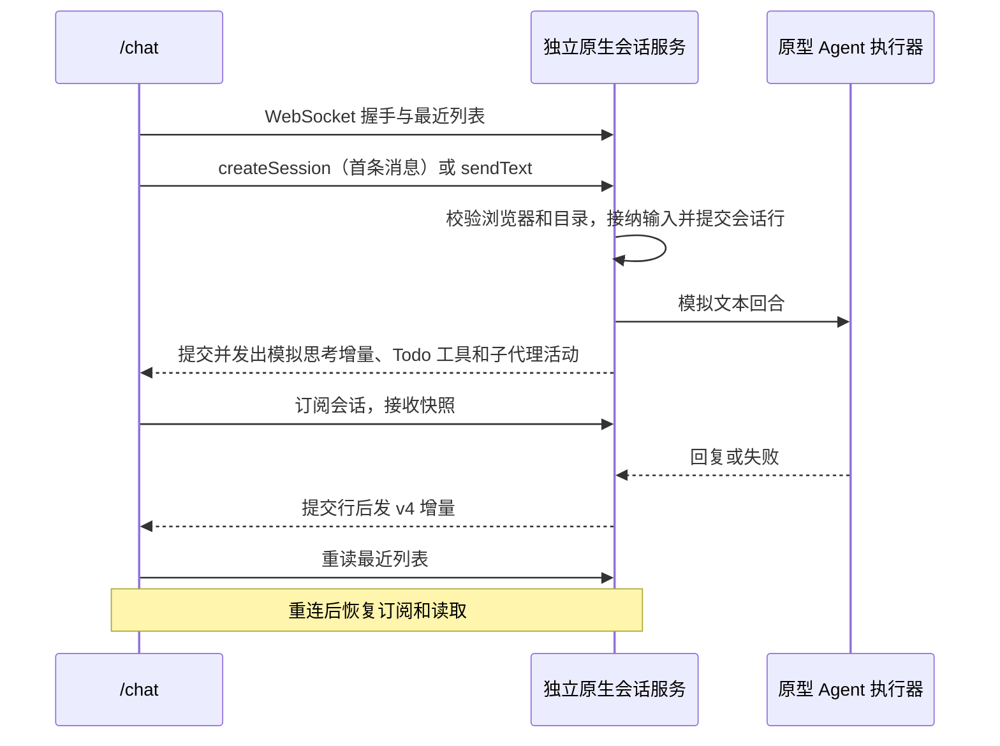

# Web Agent 聊天

## 页面与会话

在电脑浏览器直接打开 `/chat` 即可使用。页面采用现有 ZCode 工作台的双栏布局和控件样式。左栏提供新建会话和最近会话，右栏显示所选会话的工作目录、历史和输入区。新会话先选择服务端工作目录，再发送第一条消息。默认目录是 `.`，表示部署配置的工作目录根。可输入根下已有的相对目录或绝对目录，服务端验证目录及其真实路径，无需 Git 仓库。点击左栏条目即打开该会话，可向上读取更早的消息并继续对话。页面无需工号或应用角色，也无设置入口。

每个浏览器保存本入口的随机匿名标识，刷新及重连继续查看所属会话。服务器从同一标识下已有用户消息的会话生成最近列表，按目录最后一条会话活动降序取五个目录，每组按会话活动降序取五条。首次执行接收用户消息、后续回合开始及结束更新时间。同一时刻以创建时间、会话 ID 决定稳定顺序。未发送的草稿不占最近列表名额。

内存原型在每个匿名浏览器首次读取最近列表时准备两组示例历史，`docs` 和 `packages` 各三条会话。每条示例都可查看历史和继续发送。服务端仅初始化一次，最近列表按同一规则归组和排序。

聊天直接使用 ZCode 原生时间线、状态栏和 Lexical 编辑器。Markdown、用户气泡、思考流、Todo 和子代理调用使用同一套原生显示组件。工作记录按 v4 行顺序呈现。Todo 工具卡展示完成数和条目状态，上方 Todo 状态读取当前会话的计划投影。子代理卡按 `parentToolCallId` 与发起工具配对，展示名称、活动状态和结果。能独立订阅的子会话才提供下钻入口。

输入栏使用 ZCode 原生模型选择器，显示当前模型及可选的思考档位。新会话在首发时提交草稿选择，已有会话通过 v4 `switchModelConfig` 更新，切换结果由服务端配置投影确认。回合运行期间暂缓切换，刷新和重连从会话快照恢复模型。模型选项由 `/ws/chat` 的只读模型目录提供，原型按所选模型标注回合。

## 装配、接口与状态

- Web 为 `/chat` 提供独立 HTML、会话列表和页面装配。聊天客户端通过 `/ws/chat` 装配 Agent 与只读模型目录，复用现行 Channel RPC 和 v4 握手、命令、订阅、快照和历史分页。读取 `listRecentChatSessions` 获取服务器筛选后的分组。AIReq 使用原 `/ws`、工号和原业务服务，双方的公开请求和会话存储分开。
- AIReq 与 `/chat` 各自维护页面、控件组合、接入和交互。两者从 ZCode 原生显示层取得通用部件，通过各自的入口装配。`web-agent-chat` 模块只依赖通用聊天 UI、Agent 客户端、协议和 Web 平台端口。
- `/chat` 装配独立的 `MockRuntime` 和 `MockZCodeAgentService` 实例，复用 v4 协议和会话状态实现。原生会话服务拥有行、Todo 计划、子代理活动、命令决定、活动时间和订阅。原型 Agent 对每条已接纳并开始执行的输入在服务端分阶段提交模拟思考增量、Todo 工具运行和完成、子代理运行和结果，最后提交回复。模拟复核的记录留在父会话中。目录仅用于归组和选择时的只读校验。
- Web 持有选择、按会话或新会话草稿隔离的输入及服务端事实的显示投影。先订阅再读取初始快照。按 v4 字节上限分片；订阅回执前收到的帧故障在回执后触发恢复。新快照不得使已分页的历史出现无法补回的缺口。重新连接时重做握手、恢复所选会话订阅并重读最近列表；写操作不自动重发。发送决定未知时，切换会话核对历史不丢失输入，用户可恢复该草稿或明确放弃。无效目录在接纳前明确拒绝；示例与新会话按同一真实路径归组。Agent 执行失败显示明确的失败状态。当前聊天历史保留到服务进程重启。
- 单次聊天命令的 UTF-8 JSON 上限为 4 MiB（含命令封套），超过上限在接纳前拒绝。快照在 v4 逻辑帧预算内取连续尾窗，未纳入尾窗的行仍可向上分页读取。

## 验收

- 新匿名浏览器的最近列表显示两个目录，每个目录三条示例会话。打开示例可读取正文并继续聊天，重复读取和重连保留原会话。
- 新浏览器直接访问 `/chat`，在非 Git 目录创建会话并发送。打开已有会话、刷新和重连后读取历史并继续。检查网络与模块资源，仅加载聊天入口并连接独立 Agent 通道。
- 验证 AIReq 和聊天会话的 ID、目录及历史不能跨入口使用，匿名浏览器间也不能读取对方会话。复用现有 v4 ST 帮助方法验证公开行为。
- 验证目录按最后活动排序，目录内按会话活动排序，两个维度均取前五，空草稿不入列表。发送到较早会话后按新活动重新排序。
- 在任一聊天输入框发送普通消息，验证思考增量、Todo 工具和子代理工作按实际执行顺序出现，最终回复最后出现。验证工作记录可展开，重读保留同一轮的已提交记录。
- 在新会话发送前选模，在已有会话切换后再发送，核对新回合的模型、重开后的选择和原始历史。
