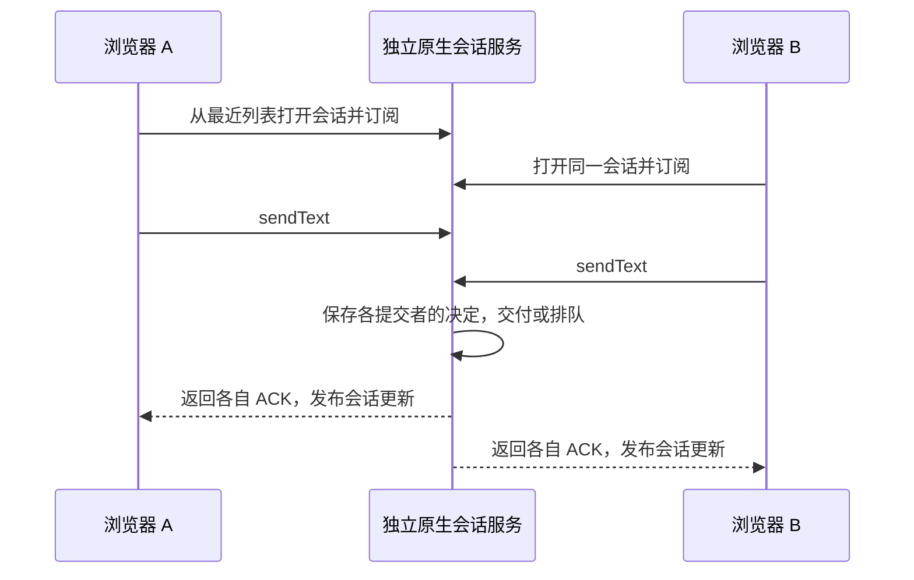

# Web Agent 聊天

## 页面与会话

在电脑或手机浏览器直接打开 `/chat` 即可使用。宽视口采用 ZCode 工作台的双栏布局，左栏提供新建和最近会话，右栏显示会话标题、工作目录、消息历史和输入区。宽度不超过 767 CSS 像素时，聊天占整列，从页头进入最近会话列表。选择已有会话或新建会话后回到聊天；从列表返回继续当前草稿。页面拥有列表开关，消息、连接和会话选择继续使用现有状态来源。聊天中可向上读取更早的消息。页面无需工号或应用角色，也无设置入口。

新会话默认使用服务端工作目录根（`.`）。窄屏显示“默认工作目录”，通过目录控件展开编辑。可输入根下已有的相对目录或绝对目录，服务端验证目录及其真实路径，无需 Git 仓库。窄屏发送和停止操作保持可见，模型名可截断但仍可打开选择器；输入区随软键盘调整，消息历史在上方滚动。紧凑页面的导航、目录、模型及收发操作提供至少 44 CSS 像素的触控区域。

每个浏览器保存随机匿名标识，用于区分消息发送者和命令回执。所有浏览器共享本入口的会话，可从最近列表打开同一会话、读取历史并实时收发，无需邀请或会话成员检查。服务器从已有用户消息的会话生成最近列表，按目录最后一条会话活动降序取五个目录，每组按会话活动降序取五条。首次执行接收用户消息、后续回合开始及结束更新时间。同一时刻以创建时间、会话 ID 决定稳定顺序。未发送的草稿不占最近列表名额。

原型每进程准备一份共享的示例历史，初始最近列表包含两个目录，每个目录三条会话。示例属于服务端数据准备；正式验收的前置历史也由测试环境准备。

聊天使用原生时间线、状态栏和 Lexical 编辑器。Markdown、用户气泡、思考流、Todo 和子代理使用通用组件；有工作记录时才显示，按 v4 行顺序呈现。子代理按 `parentToolCallId` 与发起工具配对。

模型和思考档位为会话级配置。新会话在首发时提交创建配置，已有会话通过 v4 `switchModelConfig` 更新；执行期间不可切换，刷新重连从会话快照恢复。模型选项仍由 `/ws/chat` 的只读模型目录提供。

## 装配、接口与状态

- Web 提供独立 HTML、页面装配和会话列表。`/ws/chat` 复用 Channel RPC 和 v4 握手、命令、回执查询、订阅、快照和分页。`listRecentChatSessions` 获取共享的服务端分组。AIReq 使用 `/ws`、工号和业务服务，两端的会话存储独立。
- `listRecentChatSessions()` 不接收参数；额外实参在读取列表前拒绝。每组只包含非空的 `sessions`。会话条目只返回 `sessionId`、`title`、`workspacePath` 和可选的 `workspaceIdentity`，不返回 `remoteSessionId` 或活动时间戳。侧栏用首条会话的 `workspacePath` 显示目录标题，打开会话时仍使用所选条目自己的工作区标识；前端沿用服务端按活动时间排列的顺序。
- 空闲和执行中使用相同的输入框和发送按钮，Enter 发送，Shift + Enter 换行。服务端的 `inputRouting` 为 `streamingChoice` 时，页面发送 `sendText` 并携带 `streamingBehavior: "steer"`。接纳后，消息在对话末尾显示为用户气泡，交付时切换为正式用户行。可停止时显示停止按钮，输入框上方省略通用的执行和排队说明。两个浏览器同时按空闲状态提交普通消息时，先接纳的启动执行，后接纳的作为跟进处理。停止时尚未交付的正文回到原客户端的输入框。不开放附件上传或宿主工具执行入口。详见[聊天命令](aireq/conversation.md#聊天命令和会话配置)。
- 本入口只展示父会话中的子代理记录，不开放子代理目录、下钻及独立控制；无独立 Agent 生命周期查询、会话删除、回复反馈或工具审批。
- `/` 补全使用 [共用内置命令和 Skill 契约](aireq/conversation.md#omp-内置命令和技能)，只列匿名入口有权调用的能力。原型不安装技能或执行宿主命令。
- 原型装配独立的 `MockRuntime` 和 `MockZCodeAgentService`，服务端拥有行、命令决定、待交付输入、活动时间和订阅。已开始的聊天回合按 [原型工作记录](aireq/conversation.md#原型工作记录) 模拟思考、Todo 和子代理，回复和记录不代表真实执行。目录只作归组和选择时的只读校验，不授权执行宿主工具。
- Web 只持有选择、隔离的草稿与事实投影。先订阅再读快照；帧故障按 v4 水位恢复，分页不得留下不可补回的历史缺口。重连恢复订阅和最近列表。发送回执未知时保留原命令身份和草稿，用 `queryConversationCommandsV4` 查询该匿名归属的原决定；首发查 `sessionId: null`。已接纳的首发返回会话和服务端规范工作区。仍未知则保留草稿，不自动发送；切换选择期间，迟到结果不得覆盖其他草稿或会话。
- 单次命令 UTF-8 JSON 上限为 4 MiB（含封套），超限在接纳前拒绝。快照取预算内连续尾窗，其他历史仍可向上分页。当前原型历史保留到进程重启。

## 验收

- 用服务端准备的会话验证最近列表、历史和继续发送；两层均按活动取前五，空草稿不占名额。
- 匿名进入后可在根下非 Git 目录首发；拒绝无效目录。两个浏览器可从同一列表打开会话、各自发送并实时收到对方的消息。刷新和重连可读取共享历史。验证命令回执仅提交者可查，AIReq 与 `/chat` 会话互不可读。
- 验证空闲与执行中均可用同一发送按钮或 Enter 发送，Shift + Enter 换行。执行中发送会引导当前回合，双客户端并发提交普通消息时仍可跟进排队。验证目标停止和状态恢复；原型回合展示思考、Todo 和子代理工作，正式环境只呈现 Agent 实际产生的记录。
- 在 320px 和 390px 手机视口使用触控打开最近会话、返回草稿、展开修改工作目录、首发和停止，确认页面无需横向滚动。软键盘展开时和短横屏下，验证可滚动历史且发送、停止仍在可视区。1100 × 700 的电脑浏览器验证双栏、快捷键和模型选择。
- 已接纳首发和后续发送都可用原命令身份查回执，查询不触发执行。无法确认时保留草稿。
- 验证命令补全只插入不发送；`/session info` 不产生模型回合，`/rename <title>` 修改当前标题，已列出的 `/skill:<name>` 支持首发和继续讨论，未知或未授权项明确失败。
- 会话级切换模型后，后续回合与重开快照使用已提交配置，原历史不改写。
