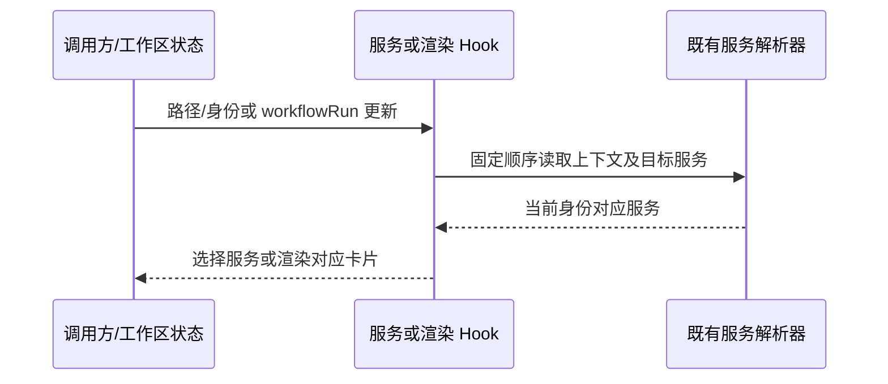

# React Hooks 依赖检查

## 目标与边界

在现有 Oxlint 中启用 `react/exhaustive-deps` 与 `react/rules-of-hooks`。
前者检查依赖遗漏、多余依赖和部分不稳定引用；后者检查 Hook 调用位置和顺序。
不安装第二套 linter，不自动修改业务代码的依赖数组。

配置沿用根 `.oxlintrc.json`。在 override 中启用 React 插件和这两条规则，保留
原有 unicorn、typescript、oxc 插件；不同时引入其他 React 默认规则。
现有 ignorePatterns、各包独立 lint 入口和 nested config 的边界保持不变。
根配置排除的组件目录与 CLI React 源码需要在专项扫描中显式纳入；嵌套配置仍按包独立生效，
不能把根 lint 的 Hooks 诊断称为全库结果。

## 接入策略

- `react/exhaustive-deps` 先设为 `warn`，存量诊断逐项复核后修复。
- `react/rules-of-hooks` 默认 `error`；2026-11-04 首次扫描发现的七个文件精确登记为
  `warn`，诊断仍可见。该例外覆盖这些文件中的同规则诊断，不是按行或按条数冻结的基线。
  后续逐文件清理并删除例外，不放宽其他规则或新增文件。
- `pnpm lint` 自动执行这些检查；CI/pre-push 沿用同一入口。
- 不使用 `lint:fix` 批量修复 Hooks。新增依赖可能重建订阅或扩大渲染范围，删除依赖
  可能移除业务上的失效条件，均须结合 owner、调用方与运行时场景判断。

## 解读诊断

诊断数量不等于 bug 数量，也不等于 Hook 数量。同一依赖数组可以产生多条诊断。
尤其是把对象整体传给 helper，或通过 `props.callback()` 调用成员函数时，检查器可能
同时报告缺少对象和成员依赖多余。应先检查 helper 的输入边界及调用接收者语义，不能
直接把所有成员替换成整个对象。

```text
闭包读取值 → 检查依赖是否覆盖 → 人工复核身份与失效语义 → 运行时验证更新范围
```

`[props]` 即使通过检查，也不能证明依赖足够窄。文件预览回调变化传播到无关侧栏的
场景仍需组件提交记录验证，静态规则不替代 React 渲染回归。

## 验收

工程回归：`node --test scripts/test/react-hooks-lint.test.mjs scripts/test/source-size-policy.test.mjs`。
该回归也纳入现有 `test:architecture` 入口。验证缺失/多余依赖可见、普通文件非法
Hook 调用阻断、精确存量文件仍告警、包内运行继承配置，以及原有插件规则不丢失。
正确的精确依赖和完整对象依赖均保持规则原有语义，不把静态检查包装成性能证明。

专项扫描使用独立的临时配置，只启用两条 Hooks 规则。Oxlint 1.60.0 的 `--no-ignore`
不会清除配置里的 `ignorePatterns`，仅在根配置上添加该参数仍会漏掉被忽略的源码。
显式列出源码目录，不对生成文件、依赖目录和语法测试 fixture 做全目录扫描：

```sh
audit_dir=$(mktemp -d)
cat > "$audit_dir/hooks.json" <<'JSON'
{
  "plugins": ["react"],
  "categories": { "correctness": "off" },
  "rules": {
    "react/exhaustive-deps": "warn",
    "react/rules-of-hooks": "warn"
  }
}
JSON
pnpm exec oxlint -c "$audit_dir/hooks.json" \
  --no-ignore --disable-nested-config --format json \
  packages/ui/src packages/desktop/src packages/web/src packages/web-share/src \
  packages/stream-animate/src packages/e2e-report/src apps/dev-docs/src \
  apps/zcode-cli/packages/tui/src apps/zcode-cli/packages/debug/src \
  apps/zcode-cli/packages/office-runtime/ui \
  apps/zcode-cli/packages/zcode-site-plugin/src/ui > "$audit_dir/result.json"
```

保留原始 JSON；按规则、类别、文件和行号汇总。缺失、多余、不稳定引用、复杂表达式、
cleanup ref 和调用顺序问题分开计数；人工复核结论单列，未验证项不得标为已修复。

## 首轮扫描记录

2026-11-04，基于 `01100ad2c9`，Oxlint 1.60.0。上面的专项扫描覆盖 2,662 个源码目录下的
文件，发现 141 个文件中的 446 条 deps 诊断，另有 18 条 Hook 调用规则诊断。根 lint 的
Hooks 检查不覆盖 CLI React 源码与基础组件目录，但包含辅助脚本与测试，得到 425 条 deps、
20 条调用规则诊断。启用前后同范围比较，原有非 Hooks 诊断没有新增或减少。

| deps 类别                    | 诊断数 |
| ---------------------------- | -----: |
| 缺少依赖                     |    174 |
| 多余依赖                     |    218 |
| 引用每次 render 都变化       |     24 |
| cleanup 读取可变 ref.current |     21 |
| 依赖数组含复杂表达式         |      9 |

优先复核的源码位置与边界：

- `ToolCallBlocks.tsx` 的 `childToolList` 读取 `onOpenWorkflowRun`、
  `disableSummaryContentAnimation`、`animateDiffCountOnMount`，但 deps 未列入这三个输入。
- `plugin-ui/adapters/usePluginUiSidePaneModel.tsx` 的 `feedScope` 读取 `tab.remoteSessionId`，
  deps 未覆盖该字段；需要验证其在同一组件生命周期内变化的场景。
- `hooks/useAppPanels.ts` 的 `handleOpenBrowserUrl` 未读取 `workspaceAbsPath`，但把它列入 deps；
  两个关闭回调还保留了已不使用的 `currentSidePaneScope`、`setIsSidePaneCollapsed`。
- `v4/WorkflowNotificationToolRow.tsx` 在 `onOpenRun` 存在时，每次 render 重建 JSX 值
  `openRunLink`，导致依赖它的 `renderContent` 回调每次更新。
- `v4/SessionPane.tsx` 的 `composerDraftGeneration` 是重读外部草稿的失效信号；虽被标为多余，
  不能直接删除。`app-shell/SidePaneTabOverview.tsx` 的 `currentTime` 同样需要保留相对时间刷新语义。
- `SidePaneTabOverview`、`useGitAutoRefresh` 中对象与成员的成对诊断先检查 helper 边界，
  不机械改成整个对象依赖。
- `resume-workflow-run.tsx` 和 `project-sidebar/grouped/task-row.tsx` 在部分 Hook 之前提前返回，
  分别有 3 条和 8 条调用规则诊断；运行时风险取决于分支在同一组件实例内是否切换。

本轮只接入检查和登记问题，未修改业务依赖，未把静态诊断认定为已经复现的产品 bug。

## 本轮修复契约与验收

- `useZCodeSessionService`、`useZCodeAgentService`、`useZCodeTaskService` 在有无
  `workspacePath` 时均按固定顺序读取上下文与工作区服务；只在返回值上选择来源。
  无路径保持当前 ServiceProvider，有路径保持现有工作区身份与远端解析规则，task 代理缓存不变。
- `ResumeWorkflowRunToolCallBlock` 的三个渲染 Hook 始终先于紧凑卡的提前返回执行；
  workflowRun 投影由调用方持有，组件不复制投影，不改变两种卡片的展示与打开行为。
- 验收：同一组件实例依次经历无路径 → 工作区 A → 同路径不同身份 B → 无路径，
  检查三个服务来源与 task 代理复用；工作流投影缺席 → 到达 → 缺席时无 Hook 顺序错误，
  紧凑卡点击仍打开 run，折叠态仍显示原输出。修复文件不再保留调用规则告警例外。



本轮运行证据：真实浏览器中临时验收页加载实际三个服务 Hook 和工作流卡片，
在 StrictMode 下按上述路径切换，服务来源及 task 代理复用正确；投影到达时紧凑卡
显示运行状态与步数，点击触发一次打开，投影移除后恢复原输出，浏览器无运行错误。
该场景使用隔离服务夹具，不声称覆盖真实远端连接；验收页不作为产品或永久业务测试保留。
`scripts/test/react-hooks-lint.test.mjs` 的存量例外场景改用尚未整改的 onboarding Hook，
四个工程门禁用例通过。

依赖复核保留影响行为的修复：SessionPane 首发动作的工作区路径/身份与 worktree
查看回调、Root 新建任务的 taskGroupService、ChatArea shell 的 active sessionId。
临时脚本提取这三处实际 useCallback/useMemo 表达式，在浏览器 React 同实例重渲染中验证：
同路径身份 A→B 后 createSession.workspaceId 和 worktree 查看目标都为 B；只换分组服务
后新草稿归属 group-B；primary sessionId 保持 null 时 activeSessionId 仍从 S1 更新到 S2。
服务及外部环境为隔离夹具，不是完整 SessionPane/分屏端到端验收。

未改两处不影响当前行为的遗漏：插件 feedScope 的 remoteSessionId 当前不参与资源键；
sessions-index 聚合已有 signature 覆盖 baseAgentService 的单调对象代际，reconcile 还会
触发 tick。保留现有失效信号，不为清除告警重复加入依赖。

补充复核：子代理停止等待态的清理由会话投影 revision 驱动。running 数组引用不变但
revision 越过停止请求水位时，也必须重新裁决 pending；不能只依赖 running 的引用变化。
验收场景：保持同一空 running 数组和 sessionId，pending.revision=1；投影 revision
从 1→2 后应移除已不在运行列表中的停止请求。
浏览器中执行实际 useEffect 表达式的隔离 React 场景已通过：revision=1 时 pending=1，
仅推进 revision 到 2 后 pending=0，running 数组保持同一引用，无浏览器运行错误。
