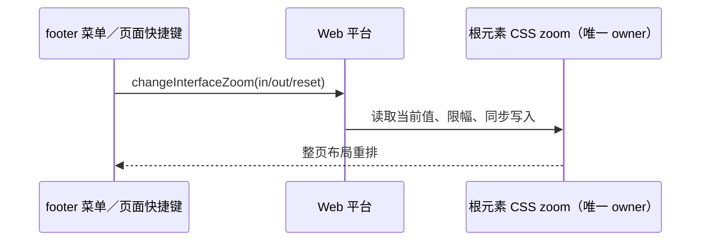
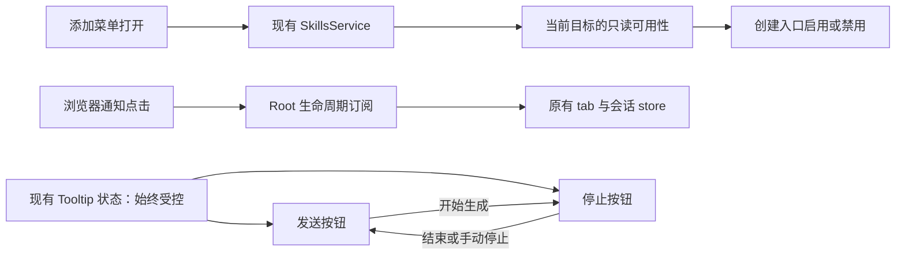

# 纯浏览器平台边界

浏览器本机操作由 `packages/web/src/platform` 实现，经 `IPlatformService` 注入 UI；工作区文件、Git、MCP、任务和设置通过 services 契约访问模拟后端。

本次只清理已裁撤的桌面端口和 UI 入口：

- 保留真实浏览器下载、外链、通知、复制及现有遥测接口。
- 删除终端设置及搜索条目，不因桌面宽度就认定浏览器具有桌面宿主能力。
- 文件管理器、外部编辑器和本机文件路径等入口不再显示；项目目录使用已有后端目录浏览器，附件使用浏览器 File。
- 跨设备配置附件依赖已移除的桌面端口，现有设置分区与搜索直接按纯 Web 可用性处理，不建立新的能力矩阵、模块或 feature-flag 框架。
- 保留电脑浏览器所需的通用控件、布局和现有功能，以及既有基础控件资产，不重新组织公共 API；产品只考虑电脑浏览器，不做手机屏幕适配或测试。

浏览器通知点击仍由 Root 订阅，按任务所属工作区激活 tab 和会话。插件创建菜单打开时只查询现有技能目录；官方创建技能缺失或连接未就绪时禁用入口，不把预期缺失当作点击后的运行异常。

模型和模式菜单各自保留本地悬停状态，提示在整个挂载期始终受控；菜单打开时关闭提示，不修改通用 Tooltip。

## 界面缩放

- 头像／项目与 Release 菜单以及设置页 footer 均提供“界面缩放”子菜单，顺序为放大、缩小、实际大小，复用现有 DropdownMenu、图标和快捷键样式。
- `IPlatformService.changeInterfaceZoom("in" | "out" | "reset")` 是唯一命令入口；Web 平台以页面根元素的 CSS `zoom` 为唯一缩放状态，初始 100%，每步 10%，限制 50%–200%，实际大小恢复 100%。`--interface-zoom` 仅是同步写入的布局派生值，用于补偿整屏视口尺寸和 Popper fixed 坐标，不能作为第二份偏好。根字号不变，不写服务端设置，不与浏览器原生页面缩放混为一谈；刷新恢复 100%。
- Windows/Linux 的 Ctrl + `+`（含 `=`）、`-`、`0`，macOS 的 Cmd 对应按键走同一命令；仅消费这些组合，不接管滚轮缩放或其他快捷键。监听属于 Web 页面生命周期，不随登录、重连或 footer 挂载重复注册。
- 验收：在电脑浏览器打开主界面和设置页菜单，分别执行三项操作；验证文字、图标和布局整体变化，实际大小回到原始尺寸；键盘增减／重置一致，达到边界后不越界，缩放后菜单和设置齿轮仍可操作。

2026-11-15 浏览器验收：1440×900 Chromium，主工作区和设置页的缩放菜单可达；
菜单放大到 110%、缩小到 90%、实际大小回到 100%；Ctrl+=／Ctrl+-／Ctrl+0
与菜单一致。连续按键分别限幅于 200% 和 50%，根容器可见高度保持 900px，
200% 时设置页菜单及缩放子菜单仍在视口内，鼠标选择实际大小成功。浏览器无运行错误。
`bun run typecheck`、`bun run lint`（0 警告／0 错误）和架构检查通过；macOS
Cmd 快捷键未在真实 macOS 浏览器验证。

验收复用现有类型、Lint、架构检查和浏览器逐页操作，不新增测试或专用冒烟脚本。正式会话须覆盖多轮发送、停止和恢复，以及模型/模式菜单开关和模型引导，确认提示组件不产生受控模式切换告警。
