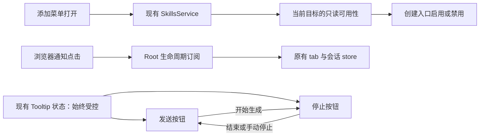

# 纯浏览器平台边界

浏览器本机操作由 `packages/web/src/platform` 实现，经 `IPlatformService` 注入 UI；工作区文件、Git、MCP、任务和设置通过 services 契约访问模拟后端。

本次只清理已裁撤的桌面端口和 UI 入口：

- 保留真实浏览器下载、外链、通知、复制及现有遥测接口。
- 删除终端设置及搜索条目，不因桌面宽度就认定浏览器具有桌面宿主能力。
- 文件管理器、外部编辑器和本机文件路径等入口不再显示；项目目录使用已有后端目录浏览器，附件使用浏览器 File。
- 跨设备配置附件依赖已移除的桌面端口，现有设置分区与搜索直接按纯 Web 可用性处理，不建立新的能力矩阵、模块或 feature-flag 框架。
- 保留电脑浏览器所需的通用控件、布局和现有功能，以及既有基础控件资产，不重新组织公共 API；产品只考虑电脑浏览器，不做手机屏幕适配或测试。

浏览器通知点击仍由 Root 订阅，按任务所属工作区激活 tab 和会话。插件创建菜单打开时只查询现有技能目录；官方创建技能缺失或连接未就绪时禁用入口，不把预期缺失当作点击后的运行异常。

模型和模式菜单各自保留本地悬停状态，提示在整个挂载期始终受控；菜单打开时关闭提示，不修改通用 Tooltip。

验收复用现有类型、Lint、架构检查和浏览器逐页操作，不新增测试或专用冒烟脚本。正式会话须覆盖多轮发送、停止和恢复，以及模型/模式菜单开关和模型引导，确认提示组件不产生受控模式切换告警。
