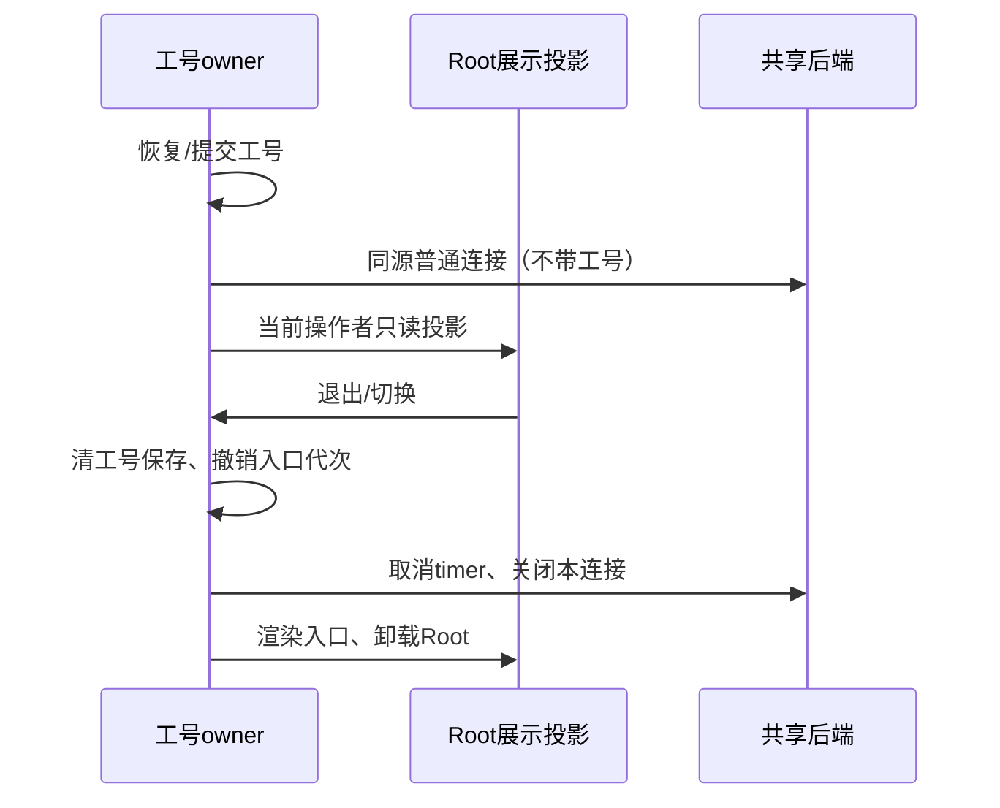

# 浏览器入口与模型配置

产品仅支持电脑浏览器。进入应用只输入工号，无密码、外部账号、OAuth 或员工目录查询。工号是自报操作者，不用于认证、权限或项目/会话数据分区。

工号 owner、保存恢复、退出事件顺序及连接时序见 `packages/web/src/auth/CONTRACT.md`。每个标签页使用 sessionStorage 恢复工号；退出或切换卸载 Root、释放本连接并回到入口，不清模型/工具凭据，不改变服务端共享项目及会话。

工号入口复用现有 Input/Button 与 text-ui 字号。已进入界面可观察当前工号并切换；侧栏及设置的退出入口执行同一浏览器退出命令。

WelcomeScreen/LoginPanel 仅是模型配置引导，保留 API Key 保存与跳过，不能再启动产品账号登录。模型设置保留 Provider 配置、API Key、模型编辑、连通性测试和后端发布的既有模型/套餐视图；不再把浏览器操作者当作套餐账号，不提供旧产品 OAuth 连接、购买授权或解绑入口。切换工号不会重置 Provider family 设置或密钥。MCP OAuth 和独立模型/工具调用凭据保留。

凭据容器检查与恢复仍遵守 ICredentialService 的现有服务边界；这不是工号退出的步骤，不允许通过退出清空凭据。Web 网络客户端不新增整库恢复权限。

验收必须在两个独立浏览器上下文输入不同工号，确认共享项目/会话，且一个退出不干扰另一个连接；同时确认模型 Key 配置保存、文件树、Git、已有预览仍可用。旧产品 OAuth 专属回归规格不再建立兼容要求，不恢复退役 App 测试。
