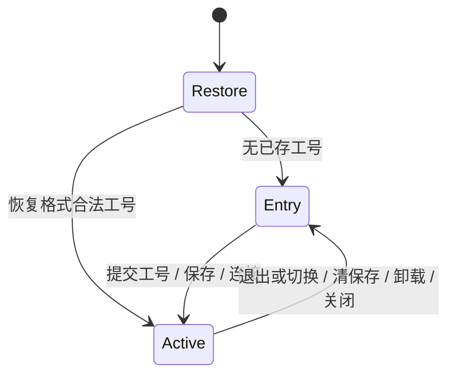
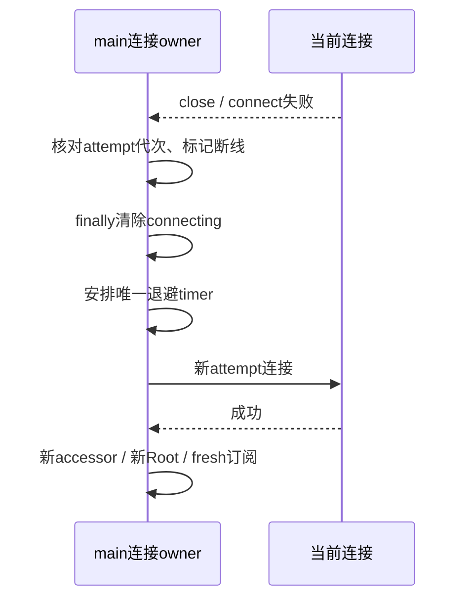

# 浏览器工号入口

唯一 owner 是每个浏览器标签页的 EmployeeEntry controller；工号是自报操作者标识，不验证本人，不是认证或模型凭据。连接与普通 AIReq 请求显式携带已校验工号，用于身份留痕、幂等和用户／客户端草稿及原生会话隔离，不用于角色权限。全部合法工号均可配置、认领或代办；来源 owner、联系人与负责人不授予独占操作权。服务器不维护登录态，各工号共享同源 `/ws` 项目和配置；合法身份／clientId、参数、对象及会话归属、版本、幂等与阶段门禁仍须校验。不能将工号写进 v4 帧。

使用 sessionStorage `zcode:employee-number` 保存当前标签页工号。恢复缓存和提交输入都先 trim，再严格匹配 `^[a-z][0-9]{8}$`，不转小写、不转数字，保留前导零；非法缓存清除，非法输入原位提示。存储失败可继续当前页使用，并明确提示刷新不能恢复。退出/切换清除该键、撤销入口代次、关闭当前连接并回到输入页；不删除服务器数据、浏览器外观或模型/工具凭据。UI user 只是当前工号的展示投影，不另建业务数据分区。

进入后的工号展示与退出／切换复用既有侧栏账户入口；入口组件不渲染顶部操作者栏，
不改变主界面的全高布局。连接、保存恢复和共享数据语义不受展示位置影响。

连接生命周期唯一 owner 为 main.tsx bootstrap。EmployeeEntry 保留 createEmployeeEntry/EmployeeEntry API，复用当前 ThemeHeroVisual（显式主题，无伪造 store）、Input/Button 和主题 token。标题为“以AI为中心的需求管理平台”，副标题说明需求澄清、方案评审与需求进度，不再承诺 Issue 功能；输入错误、持久化错误、提交 busy 明确展示。连接加载、断线、重试和退出由 main owner 管理；失败不能留在 loading，旧连接结果不得影响新身份。

旧产品 OAuth 页面、回调、token交换、账号恢复和 OAuth RPC 均退出产品路径，不提供兼容假账号。旧 `/remote` 路径和 `?remote=` 在启动时规范化为 `/`，不解释授权参数或转接旧 Host。Provider 配置、API Key、MCP OAuth 等模型/工具凭据仍由原服务负责。

验收：空白不能进入；输入工号进入，仅在侧栏账户入口显示工号，顶部无额外栏、主界面保持全高；刷新恢复；侧栏退出后回到入口、模型Key仍在；两独立浏览器工号不同但项目及业务事实共享，绑定身份／clientId／对象的原生业务会话和未发送草稿不串用，订阅仍按连接归属；Network 无旧账号请求；成功连接后令首次重连失败，恢复后无需刷新继续连接；耗尽后手动恢复有效。以上是验收要求，不是本次文档同步的实测结果。
