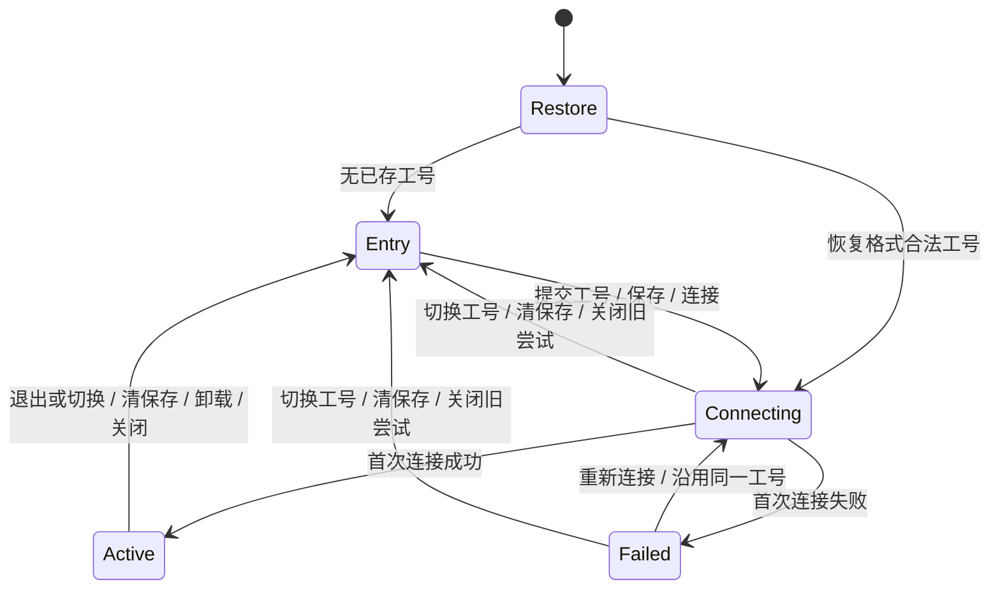
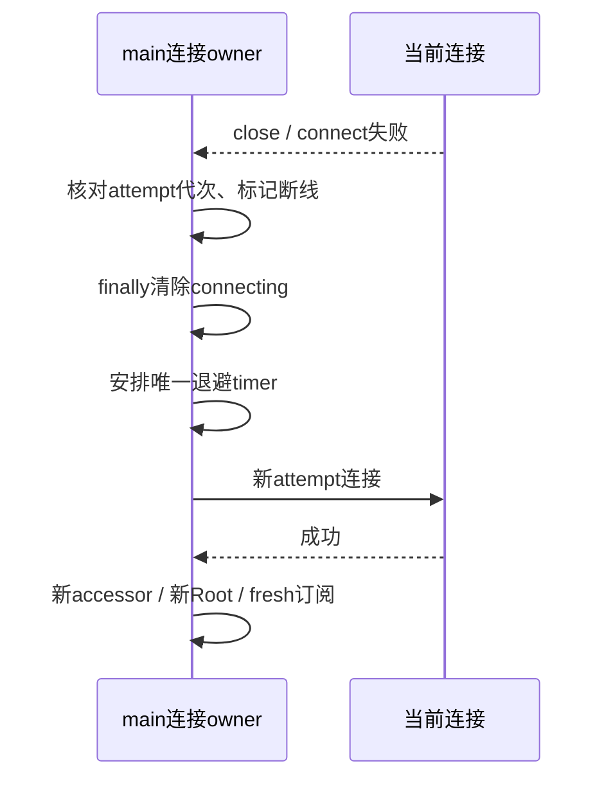

# 浏览器工号入口

唯一 owner 是每个浏览器标签页的 EmployeeEntry controller；工号是自报操作者标识，不验证本人，不是认证或模型凭据。连接与普通 AIReq 请求显式携带已校验工号，用于身份留痕、幂等和用户／客户端草稿及原生会话隔离，不用于角色权限。业务操作按项目角色、对象和版本门禁校验。服务器不维护认证登录态；在线人员只读投影来自已连接的工号与来源 IP，各工号共享同源 `/ws` 项目和配置；合法身份／clientId、参数、对象及会话归属、版本、幂等与阶段门禁仍须校验。不能将工号写进 v4 帧。

使用 sessionStorage `zcode:employee-number` 保存当前标签页工号。恢复缓存和提交输入都先 trim，再严格匹配 `^[a-z][0-9]{8}$`，不转小写、不转数字，保留前导零；非法缓存清除，非法输入原位提示。存储失败可继续当前页使用，并明确提示刷新不能恢复。退出/切换清除该键、撤销入口代次、关闭当前连接并回到输入页；不删除服务器数据、浏览器外观或模型/工具凭据。UI user 只是当前工号的展示投影，不另建业务数据分区。

登录页、帮助与普通业务页面不携带演示／mock 环境说明或后端来源身份；真实能力限制集中记录在 `docs/specs/aireq/contract-design.md#发布边界` 的上线限制及 `docs/architecture/mock-backend.md` 的后端替换契约。工号仍是自报操作者而非可信认证，不增加虚假认证承诺；字段说明、格式错误、连接失败与存储失败按实际事实提示，不用常驻内部说明替代正式失败语义。

进入后的工号展示与退出／切换复用既有侧栏账户入口；入口组件不渲染顶部操作者栏，
不改变主界面的全高布局。连接、保存恢复和共享数据语义不受展示位置影响。

连接生命周期唯一 owner 为 main.tsx bootstrap。EmployeeEntry 复用当前 ThemeHeroVisual（显式主题，无伪造 store）、Input/Button 和主题 token。标题沿用工作台名称“AI 需求协作”，副标题说明需求澄清、方案评审与需求进度，页脚仅保留 ZCode 品牌。输入错误、持久化错误和首次连接错误使用错误表面及对应前景，正常字号错误信息在浅色与动效主题内均须达到 4.5:1 对比度。

首次连接期间仍展示居中的入口及只读工号，通过状态文本说明正在连接。首次连接失败在同一入口提供「重新连接」和「切换工号」，焦点进入「重新连接」。main 投影连接中／失败以及对应重试动作，EmployeeEntry 仅负责呈现；重试沿用原工号和连接代次，切换后清除保存工号、废止旧尝试并聚焦空工号输入。验收覆盖已缓存及刚提交的工号、失败后重试成功、连接中或失败时切换、旧连接结果迟到，以及两套主题错误文本。工作台已进入后的断线恢复沿用右下角提示，旧连接结果不得影响新工号。

登录入口只处理工号，不解释旧 OAuth、`/remote` 路径或 `remote` 查询参数。Provider 配置、API Key、MCP OAuth 等模型／工具凭据仍由各自服务负责。
