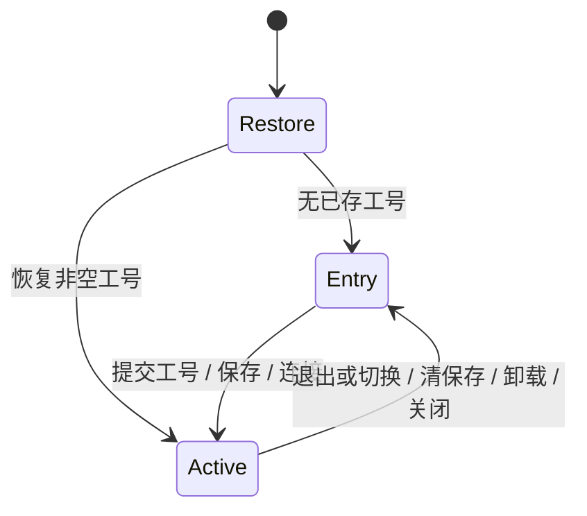
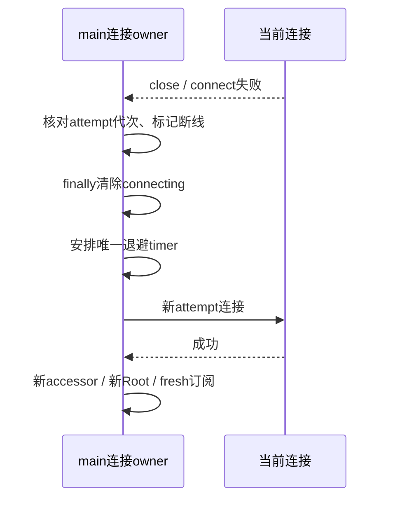

# 浏览器工号入口

唯一 owner 是每个浏览器标签页的 EmployeeEntry controller；工号是自报操作者标识，不验证本人，不是模型凭据、RPC 身份或权限。服务端不维护工号登录态，所有工号使用同源 `/ws` 的同一套项目与会话。工号不进入 clientId、workspaceIdentity、订阅或 v4 帧。

使用 sessionStorage `zcode:employee-number` 保存当前标签页工号，刷新恢复；空白输入不准入，提交前 trim。存储失败可继续当前页使用，并明确提示本次不能保存。退出/切换先清除该键并撤销入口代次，然后取消本标签页 timer、关闭连接并渲染输入页（卸载当前 Root）；不删除服务器数据、浏览器偏好或模型/工具凭据。UI 的 user 仅为 owner 的只读展示投影，不参与数据分区，不写回 owner。

连接生命周期唯一 owner 为 main.tsx 的 bootstrap 实例。每次只允许一个连接过程和一个重试 timer。失败先清 connecting，再安排有限退避；旧 attempt 的迟到 close 不得影响新连接。连接断开立即撤销当前 socket 并渲染断线页（卸载旧 Root/订阅），恢复使用新 accessor 和新 Root。七档退避耗尽后显式手动恢复，online 仅是额外恢复入口；首次失败仍提供手动恢复。退出后所有回调失效。

旧产品 OAuth 页面、回调、token交换、账号恢复和 OAuth RPC 均退出产品路径，不提供兼容假账号。旧 `/remote` 路径和 `?remote=` 在启动时规范化为 `/`，不解释授权参数或转接旧 Host。Provider 配置、API Key、MCP OAuth 等模型/工具凭据仍由原服务负责。

验收：空白不能进入；输入工号进入并显示当前工号；刷新恢复；退出后回到入口、模型Key仍在；两独立浏览器工号不同但项目/会话相同；Network 无旧账号请求；成功连接后令首次重连失败，恢复后无需刷新继续连接；耗尽后手动恢复有效。
