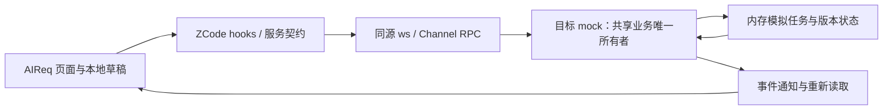

# AIReq 迁移到当前 ZCode：实施待办

## 0. 用户已确认的目标与授权边界

AIReq 是基于旧版 ZCode 前端开发的需求管理原型。本次把 AIReq 的业务迁移到当前 ZCode 项目，使用当前 ZCode 的前端基座、组件与展示效果，不再复制维护旧版前端。

当前迁移尚未完成。用户已指出左下角、点击后的设置界面及 AIReq 操作逻辑不保真；上一轮“85 项全部完成”的结论撤回。第 12 节只保留曾执行的技术检查和局部运行记录，不能作为产品保真验收。相关条目重新打开，本轮修正与实际原版操作证据见第 13 节。

| 决策面                                         | 已确认依据                                            |
| ---------------------------------------------- | ----------------------------------------------------- |
| 产品功能、业务规则、页面内容与原型交互         | AIReq 当前实际开放的原型                              |
| 可见业务入口、字段与操作语义                   | AIReq 当前可达功能，不保留原普通聊天产品并列入口      |
| UI、布局、颜色、主题、字体、控件及全部展示效果 | 当前检出的 ZCode 和 `DESIGN.md`                       |
| 工程组织、服务接入、协议及模拟后端             | 当前 ZCode 架构                                       |
| 后端深度                                       | 服务端内存原型，不实现真实模型、Git／MR、数据库或认证 |

**只迁移 AIReq 功能，不迁移其架构或视觉实现。架构、UI、配色、布局和全部显示效果以当前检出的 ZCode 为准，不复刻原版坐标、间距或分栏比例，也不重建已经合理的实现。**

这里的“当前／最新 ZCode”指目标仓库当前检出的前端实现，不表示拉取上游新版本、升级依赖或与上游快照对比。

### 明确不做

- 不修改源仓库 `oh-my-pi`；它只作为迁移参考，不成为 ZCode 的运行时依赖。
- 不搬入 OMP CLI、TUI、真实 Agent 运行时、Host、Relay、独立 worker 或要求另启 OMP 的服务链。
- 不接真实模型、Git／MR 平台、业务数据库、人员目录、麦克风识别或真实 Skill 文件写入；现有原型中的这些动作仍为明确标注的模拟。
- 不恢复已停用的 SR 编码、开发计划／执行 Agent、自动测试、代码修复、固定通过验收或旧交付流水线。
- 不新增另一套旧版 ZCode 通用组件库、旧主题、旧前端工程、独立原型后端或双轨入口。
- 不恢复 AIReq 已裁撤的自由聊天、普通任务列表、文件树、Git 审查、Office／PDF／PPTX 预览、通用白板、内嵌浏览器等产品入口。输入框已有的 Sketch 绘图辅助不等于恢复通用白板。
- 只面向电脑浏览器；不做手机／平板／触屏适配或屏幕验收。
- 不顺带升级依赖、整改全库告警、重构无关代码或提交 Git；保留无关本地改动。

## 1. 源码与规则定位（先按模块阅读，不预载整个仓库）

### 源端：`F:/code2026/oh-my-pi`

当前实际业务前端在 **`packages/aireq-frontend/`**，不是 `vendor/zcode-frontend/preview/`，也不是根目录的旧 HTML 样稿。

| 内容                           | 源端路径（相对源仓库）                                                                                                                                                                                              |
| ------------------------------ | ------------------------------------------------------------------------------------------------------------------------------------------------------------------------------------------------------------------- |
| 实现边界与演示说明             | `packages/aireq-frontend/README.md`                                                                                                                                                                                 |
| 同一应用入口与装配             | `packages/aireq-frontend/app/bootstrap.tsx`、`app/AIReqApplication.tsx`                                                                                                                                             |
| AIReq 页面、领域与数据源接口   | `packages/aireq-frontend/packages/ui/src/aireq/`                                                                                                                                                                    |
| 登录与工号                     | 上述目录的 `AIReqEntry.tsx`、`identity.ts`、`browserStorage.ts`                                                                                                                                                     |
| 导航、项目与 Release           | `AIReqSidebar.tsx`、`AIReqProjectReleaseMenu.tsx`、`AIReqProjectSettings.tsx`                                                                                                                                       |
| 提案与阶段交互                 | `AIReqWorkbench.tsx`、`AIReqContext.tsx`、`AIReqRequirementDraft.tsx`、`AIReqRequirementList.tsx`、`AIReqRequirementSearch.tsx`、`AIReqWorkflowTimeline.tsx`、`AIReqPhaseHeader.tsx`                                |
| 评审、方案、入库               | `AIReqReviewNavigation.tsx`、`AIReqRequirementsDecision.tsx`、`AIReqRequirementPlanning.tsx`、`AIReqSrDependencyGraph.tsx`、`sr-dependencies.ts`、`AIReqProposalDeliveryControls.tsx`、`AIReqProposalPrHandoff.tsx` |
| 正式需求与分析                 | `AIReqFormalProgress.tsx`、`progress.ts`、`planning.ts`、`AIReqRequirementAnalysisPage.tsx`、`progress-scheduler.ts`、`AnalysisRunConfirmation.tsx`、`BranchCopy.tsx`                                               |
| Issue                          | `AIReqIssuePages.tsx`、`issues.ts`                                                                                                                                                                                  |
| Skill、自动化与输入辅助        | `AIReqSkillDesignPage.tsx`、`AIReqSkillFilePreview.tsx`、`AIReqAutomations.tsx`、`AIReqSketchButton.tsx`、`AIReqSpeechInputButton.tsx`                                                                              |
| AIReq 设置                     | `AIReqAgentModelSettings.tsx`、`AIReqPersonalizationSettings.tsx`、`AIReqPersonalConfigScope.tsx`，以及 `packages/aireq-frontend/packages/ui/src/SettingsPage.tsx`                                                  |
| 共享类型、业务派生与样例       | `types.ts`、`data-source.ts`、`domain.ts`、`mock/`（均在上述 aireq 目录）                                                                                                                                           |
| 当前网络客户端、操作／事件参考 | `packages/aireq-frontend/client/remote-data-source.ts`、`backend/contract.ts`                                                                                                                                       |
| 服务端内存原型                 | `packages/aireq-frontend/backend/prototype-data-source.ts`、`prototype-issues.ts`、`scope.ts`、`mock-services.ts`                                                                                                   |
| 源端需求及验收参考             | `openspec/specs/aireq-browser-workbench/spec.md`；涉及提案业务时补读 `openspec/specs/aireq-requirement-intake/spec.md`                                                                                              |

注意：`app/`、`backend/` 等省略前缀均指 `packages/aireq-frontend/` 下的目录；页面文件名省略前缀均指该包的 `packages/ui/src/aireq/`。读取实现前重新核实源端当前文件，避免把调查时的旧行号当固定版本。

`aireq-layout-prototype.html` 及 `packages/coding-agent/src/aireq-workbench/` 含旧编码流程，不能作为整包搬运清单。共享原型正常可达页面才是功能盘点入口；即便契约或组件文件中仍有旧动作，也不能据此恢复停用能力。源端要求保持 OMP 专属部署、旧 HTTP 路由或冻结客户端的条款不直接约束目标集成方式，目标按当前 ZCode 契约接入；业务含义与可观察行为不能借改传输而丢失。

### 目标端：`F:/code2026/ZCode`

- 产品及边界：`AGENTS.md`、`DESIGN.md`、`docs/project-goal.md`、`docs/architecture/mock-backend.md`、`docs/architecture/pure-web-module-ownership.md`。
- Web 登录／启动／连接：`packages/web/src/main.tsx`、`packages/web/src/auth/EmployeeEntry.tsx`。
- UI 主壳：`packages/ui/src/aireq/shell/AIReqApplication.tsx`，经 `@zcode/ui/aireq` 接入 Web。
- 业务侧栏与设置：`packages/ui/src/aireq/shell/`、`packages/ui/src/aireq/settings/`；通用控件与布局资产保留复用，不再把原 App／Root／SettingsPage 当作另一套产品入口。
- 复用基础：`packages/ui/src/components/ui/`、`styles.css`、`settings/SettingsPageParts.tsx`、`v4/`、`hooks/`、`store/`。
- 服务与 mock：`packages/services/src/`、`packages/shared/src/`、`packages/client/src/remoteServiceAccess.ts`、`packages/server/src/mock/index.ts`、`mock/domains/`、`mock/runtime.ts`。
- 模块登记、公开入口和实现位置先依据架构上下文确定，不在本清单臆造现有 module-id 或文件。

## 2. 实施顺序与前置产物

按 2 → 3 → 4 → 业务模块 → 10 的顺序推进。先固定公共契约与状态所有权，再做各页面；可以在公共边界明确后并行独立业务模块，共用主壳／契约须指定唯一集成负责人。

- [x] 从目标仓库根目录运行 `node scripts/check-workspace-freshness.mjs`；代码修改前使用 architecture-governance skill，运行 `pnpm architecture:check --changed`，读取目标模块的受控上下文。
- [x] 触及会话、项目／workspace、roots 或相关状态前使用 session-management skill；改 UI 前阅读 `DESIGN.md`，涉及技能领域先读 `CONTEXT.md`。
- [ ] 盘点源端当前可达页面、按钮、菜单、键盘操作、材料、设置字段及成功／失败／空态，建立“源功能 → 目标页面／服务 → 验收场景”覆盖表，放入目标端本次规格；不得只凭组件名判断功能已开放。
- [x] 在写行为代码前更新目标仓库对应 spec；缺失部分按现有 docs 约定建立迁移规格，不因源仓库使用 OpenSpec 就初始化另一套规格体系。
- [x] 规格明确唯一状态所有者、领域 ID、项目／Release／IR／SR／Issue 归属、工号与配置修改权、接口／事件、版本失效、幂等及失败行为；涉及异步与状态流转用图说明。
- [x] 同步 `docs/project-goal.md` 的产品入口及可见功能范围：本次用户已授权以 AIReq 登录／主界面／设置取代原产品入口，不再沿用“所有原业务默认可见”的旧任务约束。
- [x] 登记源端代码与源端规格的冲突，按本次已确认范围决定迁移落点；不得默默丢功能，也不得把未实现的真实能力或待定需求扩为本次工作。确实改变产品规则的设计冲突才提问。

## 3. 当前 ZCode 基座与模拟后端接入

- [x] 以新增 AIReq 业务模块接入目标工程，迁移必要领域逻辑、页面与样例数据，通用壳仅做必要接线；不要整包替换目标 `packages/ui`、复制源端的通用组件或降级目标依赖。
- [x] 在 `packages/services` 定义浏览器安全业务契约及 descriptor，按现有方式补齐 channel、accessor、客户端代理和 mock 集中装配；跨包只用公开入口。
- [x] 盘点并映射源端 `backend/contract.ts` 中当前可达业务所需的方法、事件、参数、结果与错误。按目标同源 `/ws` 二进制 Channel RPC 提供能力，不额外保留旧 HTTP＋事件 WS 客户端或第二个服务进程。
- [x] 普通 AIReq 领域服务方法不冒充 v4 会话帧；确实涉及会话时复用现有 v4 协议与渲染链，严格 schema 自校验，不伪造 `subscriptionId`／`seq`／`logEpoch`。
- [x] AIReq 业务数据与模拟任务唯一由目标 mock 服务持有；页面通过 hooks／services 读取、操作和订阅，不能在浏览器另建业务数据库或以 localStorage 业务副本代替后端。
- [x] 共享项目、Release、需求、Issue 和报告不按工号复制或隔离；未发送草稿、连接订阅、浏览选择及外观偏好保留各自正确作用域，不因“共享数据”而混成全局状态。
- [x] 浏览器刷新／断线／关闭不重置已接纳业务或服务端模拟任务；重连读取当前状态，不自动重发消息、确认或创建操作。mock 进程重启才恢复初始样例。
- [x] 样例回复、报告、MR、分支、Skill 生成／保存由服务端给出明确模拟结果；已有支持的操作必须改变可观察状态，失败不能返回假成功或回退样例掩盖错误。
- [x] 数据读取、材料生成中／缺失／失败／过期和连接异常分开表达，失败保留输入与当前目标；事件重读不得用旧请求结果覆盖新选择。
- [x] 沿用目标服务日志、平台能力及浏览器安全边界；不把 Node、Bun、真实文件操作或 OMP 专属模块带入浏览器依赖图。

状态与调用边界（实施规格须据最终接口补充事件顺序）：

## 4. 登录、主界面、导航与视觉升级

- [x] 迁移 AIReq 现有登录产品内容：标题“以AI为中心的需求和ISSUE管理平台”、业务副标题、工号表单、进入工作台、加载／错误及退出行为。工号为一个小写 a–z 字母加八位数字，保留前导零；不添加密码、OAuth、API Key 登录或本人验证。
- [x] 登录页保留 AIReq 的业务组织，使用目标现有登录背景、卡片、图标壳、字阶、Input 和 Button 实现；不复制旧主题 CSS 或把业务登录改回旧产品账号流程。
- [ ] 迁移 AIReq 主界面导航、提案列表、项目／Release 菜单、前进／后退和设置入口；保留当前原型默认落页、刷新恢复、项目切换及空状态语义。
- [x] 新建需求提案、自动化、Skill 设计、需求分析、正式需求及 Issue 三页均有实际工作区，不出现只可点击但无业务内容的入口。
- [x] 提案提供导航／列表、讨论与材料访问；正式需求提供表格及同页报告／材料。使用当前 ZCode 原生布局与可调整面板，保留功能上下文，不将 AIReq 的固定几何作为设计约束。
- [x] 项目切换保留当前功能页并清理旧项目对象选择；需求按有效 Release 读取，Issue 按项目读取。无项目／无 Release／无内容分别显示正确空态。
- [x] AIReq 项目是“名称＋远程仓库＋默认分支”的业务容器，Release 继承仓库；不得直接把旧目录型 `VirtualProject` 当同一模型，或向用户强加服务器目录／个人开发目录。
- [ ] 统一采用目标语义 token、`text-ui-*` 字阶、图标、控件与交互状态；浅色／深色／跟随系统及桌面窄窗口可用。布局与展示采用当前 ZCode，不携带旧版全局样式覆盖新组件。
- [ ] 所有业务页、弹窗、材料阅读区和输入框在实际父面板宽度下排版；分栏开合／拖动不造成溢出、固定旧宽度、操作不可达或重建会话。

## 5. 需求提案：澄清 → 评审 → 方案 → 模拟入库

- [x] 新建提案先进入未发送草稿；首次发送接纳后才加入列表。重复点击／失败重试不创建空提案或重复记录，失败保留文字与附件。
- [x] 迁移提案列表的搜索、筛选、排序、阶段／提出人、继续讨论及允许的草稿移除确认；正式需求与受保护历史不能被草稿删除操作误删。
- [x] 迁移 IR／SR 澄清和只读材料展示；材料包括 IR、各 SR 规格、技术方案及依赖 JSON，显示当前对象正确内容，不混入旧开发材料。
- [x] 迁移四路评审：A／B／C 独立意见与综合意见、会话切换和定向追问、人工通过／退回。缺失、失败、未完成或过期报告不能批准；需求版本变化使旧报告和决定失效，历史仍可读。
- [x] 方案通过对话生成／修订，不新增生成按钮；技术方案、SR 依赖、工期预估共同绑定当前版本，更新使旧文件确认失效。
- [x] `sr-dependencies.json` 是依赖与预估唯一来源：覆盖稳定 SR ID，保存正数工作日及非空假设、前置 SR 与原因；无依赖为空，不接受未知 ID、自依赖或循环。
- [x] 依赖材料展示只读图，前置节点指向依赖方，支持缩放、平移、连线原因及独立节点；缺失／无效／过期不绘制旧图或伪造回退数据。
- [x] 提案只有提交人，不新增负责人、开发人员或人员日期编辑；预估只读，不能直接相加工期为 IR 总周期。
- [x] 迁移方案补充／退回业务、历史查看及返回当前阶段；查看历史或切换材料不自动推进阶段、发送消息或启动任务。
- [x] 迁移逐文件确认及当前模拟入库链：确认完整有效材料 → 模拟创建分支／提交推送／自动建 MR → 展示 MR → 模拟人工外部合并事实 → 后台检查完整性与实际合入 → 自动转正式需求并记录 SR 分支。
- [x] MR 已创建／已关闭不能直接视为合入；未合入、材料不完整／过期和查询失败保持提案并显示原因。重复动作和检查不重复创建 MR、转正或分配分支。
- [x] 沿用原型服务端五秒内存检查演示及对应失败场景，不接真实 Git，不增加手填 MR 链接、自动合并或“人工确认已合入”替代门禁。

## 6. 正式需求、人员排期与进度

- [x] 正式入口呈现可展开 IR／SR 大表格，不恢复左侧正式需求树；保留当前列、搜索、状态／人员筛选、筛选及总量统计、固定表头／名称列和内部滚动。
- [x] 点击 IR／SR 仅更新同页右侧报告／材料；保留筛选、手动展开、滚动、标签和分栏宽度，不跳独立详情页、不挂载开发聊天或触发执行。
- [x] 迁移唯一 IR 负责人、SR 开发人员与起止时间安排、工号校验、修改记录、排期冲突提醒和 IR 时间汇总；正式安排不由提案预估自动换算。
- [x] 正式 SR 的开发分支必须是平台映射的非空值；分支列提供复制入口，完整名可悬停／聚焦查看，尺寸服从当前 ZCode 表格布局。复制成功／失败明确反馈，不触发行选择或 Git；缺失报异常，不能用分析分支、旧执行记录或猜测值兜底。
- [x] AI 模拟分析只给 0%～99%；仅满足当前 SR 已分析到 99%、开发分支非空且已核实合入等门禁及既有操作权限后，人工填写依据确认至 100%。禁止任意人工百分比；保留判断人、时间及依据。
- [x] IR 进度为全部 SR 算术平均，无 SR 为 0%，不独立人工修改；未实际完成不能通过四舍五入显示为 100%。
- [x] 新转正、尚未分析的 SR 保持 0%／待分析，不套用其他记录或把提案基点冒充代码分析证据；报告区分 AI 分析与后续人工确认。

## 7. 需求分析与 Issue

### 7.1 需求分析

- [x] 迁移项目分析范围、统一调度配置、任务／执行历史标签、统计、搜索／联动筛选、分页、按需读取报告、失败原因和重试。
- [x] 保留服务端唯一模拟调度器和 SR 唯一任务；项目／全局开关、已完成排除、同 SR 不重复并发、失败不阻塞其他 SR 等规则不能因移植被简化掉。
- [x] 保留源端大数据样例与 25／50 条分页语义，不能把全部报告塞进前端或仅迁移首屏样例；历史保留执行时的分支与配置事实。
- [x] 手动批量分析先确认范围与成本提示，取消不提交；需求分析覆盖全部匹配分页，不限当前页。报告弹窗、复制反馈及重试可用。
- [x] 后台刷新保留表格、滚动和打开的报告，不反复插入顶部加载提示扰动阅读；错误有固定反馈位置和明确重试，首次读取有加载态。

### 7.2 Issue 三页

- [x] 迁移新建 Issue、Issue 分析、Issue 进度；包含类型、优先级、问题说明、完成标准、唯一开发人员及可选关联正式 IR／SR。
- [x] Issue 按项目独立管理，不属于 Release、不进入 IR／SR 进度汇总；切换 Release 不清空或重建 Issue。核对源端“无 Release 可管理 Issue”的业务语义与侧栏禁用条件偏差，不能把需求页空状态错误复用于 Issue。
- [x] 创建返回稳定编号与唯一模拟开发分支，重复提交不产生多条；保留输入校验、创建结果、分支复制及失败反馈。
- [x] 保留独立 Issue 分析设置、任务、历史、报告和 Agent 模型／个性化配置，不借用需求分析角色；沿用原型修改权限及模拟分析边界。
- [x] 进度页保留搜索／筛选、同页报告／材料、完整分支查看和复制；只有合入条件满足后人工确认 100%，完成后停止自动分析，填写原因重开回到不超过 99%，不改变关联需求或回滚 Git。
- [x] 需求与 Issue 批量分析确认框各用正确范围：Issue 为当前项目全部未完成项，不受 Release 或列表搜索误限制；模拟 Token 提示不伪造真实消耗。

## 8. Skill 设计、自动化及聊天输入辅助

- [x] Skill 设计作为主界面独立工作页，迁移说明表单、可折叠左栏、设计对话／临时文件 Tabs、Markdown／代码预览及保存目标选择，不改成设置内表单。
- [x] 表单只准备完整聊天草稿，保留人工修改，由人明确发送；生成后明确选择目标并确认模拟保存，不自动发消息、生成、保存或覆盖同名 Skill。
- [x] 保留草稿摘要／完整编辑器匹配规则、Frontmatter 与正文分离、完整路径展开及目标归属说明；折叠不丢表单、编辑器、附件和消息。
- [x] 自动化保留当前实际开放的列表、筛选、编辑／操作和独立运行记录；历史只读会话不切换需求执行对象、不改变 IR／SR，不扩成真实生产工作流或调度引擎。
- [x] 迁移提案／Skill 聊天实际可用的输入框、附件、会话临时选模／思考等级及材料预览交互，使用目标已有组件与会话能力，不捎带恢复源端停用入口。
- [x] 绘图辅助只把完整 PNG 回填原草稿；语音入口仍是示例文字的编辑／追加演示，不采集音频。保留取消、失败和原草稿，不自动发送、创建提案或推进阶段。

## 9. AIReq 设置与原型操作权限

- [ ] 设置使用 AIReq 的入口、分组与业务内容：个人工具只含外观；平台配置包含项目／Release、模型、个性化、技能。视觉与表单控件使用当前 ZCode，不沿用原产品全部设置菜单。
- [x] 项目设置仅保存名称、远程仓库和默认分支；Release 继承项目仓库。只做格式校验及内存保存，不执行真实 Git 或声称仓库可访问。
- [x] 模型与思考等级按当前 AIReq 角色配置，包含需求／评审／方案／分析／Skill 设计及 Issue 分析等实际使用角色，保留默认继承、保存、取消和模拟会话绑定语义。
- [x] 个性化只编辑用户追加指令，不把内置／样例提示词预填为用户内容；保留每个 Agent 独立草稿、UTF-8 大小限制及保存／取消。
- [x] 模型和个性化未保存时，切页／离开保留“保存并离开／丢弃／取消”门禁；保存失败不离开，快捷键不绕过大小限制或只读限制。
- [x] 技能管理迁移当前可达的列表、搜索、作用域、详情及受支持交互；不把源端原型模拟保存变成真实安装或文件写入。
- [x] 保留源端共享 Web 所有者／普通访问者的原型可修改／只读规则：设置全部可查看，外观与独立 Skill 设计全员可用，平台配置写入按原型所有者限制，前端和 mock 写入口一致。工号仍非认证，不为此建设真实账号、RBAC 或多租户系统。
- [x] 将 OMP profile 等宿主概念在目标中表示为明确的模拟配置归属，不要求启动 OMP，不把切换工号当成切换后端账号、凭据、配置根或共享项目数据。

## 10. 原产品入口切换、清理与验证交付

### 10.1 一次性切换与必要清理

- [x] 从 Web 启动入口到登录、主界面与设置完整切换为 AIReq；原 ZCode 普通任务／聊天产品不作为另一套可见入口并行保留。
- [x] 清理被替代的业务入口、专属调用、死分支与失效引用，不留隐藏菜单、空页面、占位成功或兼容别名；仅删除本次切换确实淘汰且非通用的代码。
- [x] 目标 `components/ui` 全部内容、已有 mobile-ui 兼容控件及布局／弹窗／表单等通用控件必须保留，即使暂时无引用也不能以 knip 为由删除；保留底层资产不等于恢复旧产品入口。
- [x] 构建只包含实际引用资源，不复制源端 `build`、`node_modules`、发行内嵌资源或整套旧主题／图标／预览引擎；目标源码与产物不再依赖源仓库绝对路径。
- [x] 同步目标规格、项目目标、相关模块契约、架构登记和必要变更说明；不得把“模拟演示完成”写成真实模型／Git／认证／持久化完成。

### 10.2 必要验证（执行后才能勾选）

- [ ] 本轮全部代码和文档完成后，从目标根目录运行 `pnpm typecheck`、`pnpm lint`，记录实际失败与告警。修改 React 组件／hooks 后复核本次相关 Hooks 诊断；忽略文件按 `docs/testing/react-hooks-lint.md` 补做专项检查，不能因退出码为 0 忽略告警。
- [ ] 本轮全部代码和文档完成后，运行 `pnpm architecture:check --changed` 与 `pnpm build`，证明目标自身可构建；此前通过或失败只作为历史结果，不冒充本轮通过。
- [ ] 通过目标 `pnpm dev` 或目标构建产物，在真实电脑浏览器走通登录、导航、设置和每个迁移业务模块；新浏览器交互前使用相应 browser skill。不以源码检查、编译或原型旧截图代替实际页面验收。
- [ ] 验证浅／深主题及普通、较窄电脑窗口；检查弹窗限宽、分栏拖动、滚动、焦点、键盘、复制成功／失败、草稿保留和后台刷新不扰动。仅以当前 ZCode 组件／主题和本次规格为视觉依据，不与上游快照或 base 做对照。
- [x] 至少完整演示一条提案从首发到评审、方案、材料确认、模拟 MR 检查、转正的链路，并观察正式 SR 分支与初始分析状态；覆盖失败／退回／版本失效而非只测一路成功。
- [x] 验证正式需求 99%／分支／合入门禁、人工 100% 和 IR 平均；Issue 独立归属、创建／分析／完成／重开；分析分页／全匹配范围确认；Skill 明确发送／模拟保存；设置未保存离开门禁。
- [x] 使用独立浏览器上下文验证工号登录、共享业务数据、个人草稿／外观、原型所有者／访客只读及连接独立性。刷新、断线重连不重置业务或重复动作；重启 mock 恢复初始样例。
- [x] 不新增或补充任何测试文件、用例或验证脚本；仅复用已有必要检查、测试和浏览器场景，全部代码与文档完成前不执行任何验证。
- [x] 精确记录浏览器版本、入口、操作结果和未验证项；如声称 Firefox 验证，使用 Selenium＋已存在 geckodriver 驱动真实 Firefox 和隔离 profile，不拿 Chromium 代称通过，不自动安装浏览器／驱动。
- [x] 删除一次性验证脚本；在本文件记录本次实际修改、命令／浏览器验证结果与限制，仅按完成证据勾选，不自动提交或推送。

## 11. 最终完成条件

用户在当前 ZCode 中看到并使用 AIReq 的登录、主界面、设置及全部当前可达原型功能；业务结构与交互没有被普通聊天产品替代，视觉和组件来自当前 ZCode。模拟业务由目标后端经现有服务架构提供，端到端操作有真实可观察的内存状态变化，错误、权限、版本及完成门禁不丢失。应用独立于 `oh-my-pi` 运行，没有第二套旧前端／旧产品入口，没有新增真实外部能力，必要检查和实际浏览器验收有据可查。

## 12. 上一轮技术检查与局部运行记录（不构成产品保真验收）

### 12.1 实际交付

- 新增并登记 `aireq-contract`、`aireq-ui`、`aireq-mock`；公开契约位于 `packages/services/src/aireq/`，UI 位于 `packages/ui/src/aireq/`，模拟服务位于 `packages/server/src/aireq/`。业务经 `IAIReqService`／`aiReqService` 使用同源 `/ws` 二进制 Channel RPC；会话、草稿、附件继续复用现有 v4 所有者。
- Web 登录、主导航、八个工作页与五个设置页完整切换为 AIReq。移除原 App／Root 等专属入口与调用，保留 `components/ui`、mobile-ui 兼容资产及通用布局／弹窗／表单；没有第二套旧产品入口、源仓库运行依赖或独立原型后端。
- 完成提案、四路评审、方案及依赖、模拟 MR 门禁、正式进度与排期、统一需求分析、项目级 Issue、Skill、自动化及平台设置。迁移规格见 `docs/specs/aireq-migration/`，项目目标、mock 后端说明、模块契约与架构登记同步维护。
- 修复实际验收发现的首发帧先于 ACK 导致不导航、连续提案幂等 ID 复用、PNG 目标归属、Skill 回填覆盖、设置往返输入丢失、自动化 workspace／操作收据、确认弹窗宿主、历史会话只读、显式故障重连、页面高度及图署名对比度问题。补齐原本未挂载的提案信息／历史／删除菜单。
- 已接纳原生提案从私有预热转为共享会话；其他员工能读取同一 canonical 消息及已采用 PNG，私有草稿／Skill 与上传写入归属不放宽。临时模型／思考属于单次 Submission，保留于原生输入行；不把工具栏恢复 Session 默认误判为选模丢失，也不改写平台或历史配置。

### 12.2 工程检查与测试

环境：Windows x64，Node **24.20.0**、pnpm **10.33.2**。`ci:assert-node` 确认满足 `>=24`；环境没有 mise／24.14，未声称以 `mise.toml` 的 24.14 精确版本运行。

| 实际命令                                     | 观察结果                                                          |
| -------------------------------------------- | ----------------------------------------------------------------- |
| `node scripts/check-workspace-freshness.mjs` | 通过，基线新鲜                                                    |
| `pnpm ci:assert-node`                        | 通过，Node 24.20.0                                                |
| `pnpm typecheck`                             | 通过                                                              |
| `pnpm lint`                                  | 通过，**0 errors、345 条既有 warnings**；不写成无告警             |
| `pnpm architecture:check --changed`          | 通过，**0 violations**                                            |
| `pnpm test:engineering`                      | **12 文件、119 tests passed**                                     |
| `pnpm test:architecture`                     | **61 项：60 passed、1 Windows skip、0 failed**                    |
| `pnpm build`                                 | server／web 均通过；保留大 chunk 与部分构建的 plugin timings 提示 |

最后一轮完整代码门禁在最终图样式修复后执行。复核相关 Hooks：新 AIReq 文件无诊断；原生组件仍有存量告警，未机械删除草稿代际／作用域失效依赖。cleanup registry 的 Set 引用未重新赋值，附件预览 memo 已由 locale／intl 驱动；新重连回调在依赖数组中。根 ignore 的已改 `message.tsx`、`markdown-table.tsx`、`code-block.tsx` 复用本轮按专项配置的扫描，不把根 lint 冒称全组件扫描，也不扩为全库告警整改。

内联运行证明另覆盖 canonical 依赖 JSON 的 10 个合法／非法／过期边界；自动化克隆请求的稳定操作收据、范围与只读；真实 binary/ws 的 Issue 重复请求、空标题拒绝、物理断连重读；跨客户端原生输入／PNG读取与错误行、索引、workspace、ref 拒绝。没有新增永久业务测试框架或保留临时验收页面／脚本。

### 12.3 真实浏览器与页面覆盖

- 最终两个独立 Chrome profile 的 **CDP `Browser` 均为 `Chrome/157.0.8103.78`**；不是仅依据缩减版 UA。工号分别为样例所有者 `j00808874`、访客 `j00808877`，不构成真实认证。
- 入口 **`http://127.0.0.1:3041/`**，运行目标 `packages/server/dist/entry-http.js` 托管 `packages/web/dist` 的单进程构建产物。原有 3030／5173 服务未改动；没有启动 OMP 或源仓库服务。
- 深色 **1440×1000**、浅色较窄电脑窗口 **1122×763**：分别实际打开工号登录、八工作页、已接纳提案与材料、五设置页，合计 **30 份当前页面截图**；逐页读取 console／运行错误，均 **0 条**，document 无横向溢出。已查看截图，未与上游／base／旧截图比较。
- 实际切换跟随系统的浅／深媒体条件，等待 DOM 主题提交后匹配；独立 profile 的深／浅偏好互不覆盖。实际拖动提案与正式表分栏、内部滚动及横向滚动、材料 Tabs、焦点恢复、复制成功／拒绝、草稿与 PNG 保留均有操作证据。

| 页面组     | 实际覆盖                                                                                                             |
| ---------- | -------------------------------------------------------------------------------------------------------------------- |
| 登录       | 精确标题／副标题、工号正则及前导零、无密码、退出再进入                                                               |
| 八工作页   | 新建需求提案、自动化、Skill 设计、需求分析、正式需求、新建 Issue、Issue 分析、Issue 进度                             |
| 提案与材料 | IR／SR、四评审、历史只读、方案／依赖图／预估、确认及 MR 门禁、信息／操作历史／删除确认                               |
| 五设置页   | 外观、项目／Release、模型、个性化、技能；访客平台配置只读                                                            |
| 空态与故障 | 独立 empty-projects 启动、首项目无 Release 仍可管理 Issue、空 Release 无正式需求；材料／会话读取与发送故障及明确重试 |

### 12.4 关键业务实证

- **提案完整链**：`draft-demo-21` 从 PNG 首发、IR＋两个稳定 SR、A/B/C＋综合评审、退回与新轮人工通过、对话生成 design／权威依赖 JSON，至全部五文件及总确认、模拟分支／推送／MR102。访客在确认中改版本使旧确认失效。五秒检查实际覆盖查询失败、关闭未合入、已合入但不完整；只有已合入且完整才转正一次，新两个 SR 有映射分支、0%／待分析，无伪代码证据。
- **首发与共享**：正常连续首发 245／248 各自自动打开；发送故障保留完整 1280×788 PNG 与正文，明确双击重试只接纳 `draft-demo-190` 一份。最终 `draft-demo-36` 的同一 native session 恰三行，input 思考 medium、角色快照 high；第二员工读取同一回复及 32996 字节、1440×889 PNG。错误读取实际拒绝；私有 Skill 的其他 actor 原生／业务读取均拒绝。该验收草稿随后经真实确认菜单移除，取消此前保持记录，历史阶段删除禁用。
- **正式需求**：实测 IR 61.2% 算术平均、99%／分支／合入门禁、reasoned 人工 100% 与 AI 报告保留；同名人员按工号区分、排期冲突及非法日期拒绝。筛选、展开、scrollLeft 300、右栏 Tabs／宽度保留；真实剪贴板允许／拒绝有明确反馈。
- **规模分析**：启动时 `analysis-scale` 的唯一调度器提供 300 任务／1000 历史；25／50 分页及末页分别 6/6、20/20 已读。末页确认仍覆盖全匹配 133 项，取消不增加历史，接纳后 1133；单项失败不阻断其他任务，显式单项重试仅增加至 1134。项目开关、配置即时保存及访客共享只读、打开报告期间背景刷新与 Escape 焦点保留均实测。
- **Issue**：无 Release 的项目仍能创建；完整安全／高优先级、唯一开发人、可选 SR 关联创建为 `ISSUE-0004`，0%／待分析、分支可复制。克隆同一 requestId 只得到一份 `ISSUE-0005` 与同一分支，空标题拒绝；关闭并重建真实 ws 后记录／历史不重置。独立分析设置、issue-analysis 角色报告、搜索只命中一项但批量确认全部四个未完成项、完成／原因重开及不改变 IR 均已验证。
- **Skill／设置／自动化**：Skill 表单只准备，人工修改及折叠／Tabs／完整 PNG 保留；明确发送生成两文件，v2／v3 显式按目标保存、旧确认失效、同名不覆盖，Frontmatter／路径／目录作用域正确。九角色、保存／取消、100KiB UTF-8、跨客户端版本冲突与未保存离开门禁、访客实际 RPC 写入拒绝均已验证。自动化 CRUD／筛选／暂停继续、权威 workspace、脏编辑门禁、stopped 记录、只读会话／task／workpool／JSON与文本输出及失败重启已操作；没有真实生产引擎。
- **连接生命周期**：接纳七个手动分析后实际关闭 owner 应用页，Chrome 进程 exit 0；之后重开同一 profile，clientId 保持，重新输入工号进入默认需求分析，原七条已完成／跳过、运行中 0，连同五条种子历史共 12 条，没有自动重发。会话模拟读失败的明确“重新连接”恢复原 session。重启 mock 后先前新增 Issue 不保留，恢复三个初始 Issue；empty-projects 也仅在独立启动场景生效。

### 12.5 边界与清理

- 全部模型、分析、报告、MR、分支、Skill 生成／保存均为明确标注的服务端内存模拟；没有真实网络模型、Git、MR、数据库、认证、麦克风识别或 Skill 文件写入。
- 仅电脑 Chrome；未声明 Firefox、手机、平板或触屏验证，未安装浏览器／驱动。没有人工丢弃单个 ACK 帧；未知回执仍由既有 command registry 实现，不把“拒绝后重试”和“重连读取”伪称所有丢帧组合均已注入。浏览器 File／Sketch 使用非 staged 路径，不声称验证宿主 staged 移交。
- 验收使用多次独立 mock 启动，样例编号与内存状态分次记录，不承诺跨进程持久化。临时验证均内联或已删除；截图留在工具临时目录而非产品依赖。未提交或推送 Git。

上一轮格式及文档检查曾通过；“原始 85 项已全部完成”的整体结论不成立，已撤回。控制台无错误和编译通过不能证明设计与操作等价。

## 13. 用户反馈后的保真修正

原版已按其真实启动器在 `http://127.0.0.1:4173/` 启动，后端为 4174；仅运行，未修改源仓库代码。当前 ZCode 的视觉依据仍是本仓库当前组件与 `DESIGN.md`，不与上游或 base 快照比较。

本轮已实际登录原版、打开左下角项目／Release 菜单、设置、外观、模型设置、返回工作区并重新进入设置，以及打开业务流程帮助。确认的差异：

- 原版主底栏复用 `WorkspaceSidebarFooter`，头像旁展示项目与 Release；点击展开身份／项目／Release／管理／帮助，再复用原生主题菜单。目标错误地改成两个常驻 HTML select、独立图标条与硬编码所有者文字。
- 原版设置使用完整窗口的原生设置侧栏和内容框；目标只隐藏中间工作区，留下业务导航，形成两套侧栏。应抽取当前 ZCode 已有的设置展示框架，不能另造简化外壳。
- 原版首次设置进入项目配置，手动选择的分区在返回后再次进入时保留，管理项目明确定位项目配置；目标齿轮总是强制外观。原版明确返回原生讨论工作区，不能擅改成另一个导航规则。
- 原版菜单帮助有八个业务步骤、滚动阅读区与关闭后焦点恢复；目标三句话弹窗丢失了实际可达内容。迁移时去除已经裁撤的个人 OMP／真实数据库措辞，保留共享内存原型的实际流程规则。

修正后必须实际复走原版对应操作，并验证当前 ZCode 原生底栏默认消费者不变、设置只有一套可见侧栏、未保存离开门禁及原生草稿／附件／会话保持。未取得修正后证据前，不重新宣称全部完成。

### 13.1 用户明确的最终完成标准

最新裁决：AIReq 只迁移功能与业务操作语义；架构、UI、布局、配色、字体及全部显示效果以当前检出的 ZCode 与 `DESIGN.md` 为准。此前要求与 AIReq 控件位置、页面分区、默认比例或坐标一致的条款撤销。最终运行验收仅在代码和文档全部完成后执行，不新增测试；此前局部技术结果不自动满足这一标准。

- [ ] 登录与主导航／底栏功能完整，采用当前 ZCode 原生布局、控件与颜色。
- [ ] 新建提案、四阶段讨论、材料与历史功能完整，复用当前 ZCode 会话和面板。
- [ ] 正式需求的列、筛选、展开及同页报告／材料功能完整，采用当前 ZCode 表格和阅读控件。
- [ ] 需求分析的配置、范围、任务、历史、报告、分页及批量操作。
- [ ] 新建 Issue、Issue 分析、Issue 进度各自的字段、范围、报告及同页操作。
- [ ] Skill 设计的表单、折叠、会话、预览及显式保存功能完整，采用当前 ZCode 原生控件与工作区布局。
- [ ] 自动化／工作流列表、筛选、编辑、运行记录及只读会话。
- [ ] 五项设置的完整原版功能、当前 ZCode 原生设置框架及保存／返回流程。
- [ ] 所有页面实际截图、对应点击、控制台零错误零告警和最终工程检查。

### 13.2 ZCode 视觉层级修正

- 视觉唯一依据是当前 ZCode；AIReq 仅提供功能与操作语义，不作为主界面、业务页或设置的视觉／布局基准。
- 用户截图指出主导航和内容区同色。根因：Zai Dark 的 `sidebar` 与 `background` 同值，而原生浏览器窗口底层使用 `background-win-alt`。已将主外壳及导航改用该原生底层，内容区明确使用 `background`；不修改全局主题、不写死颜色，不增加状态或抽象。
- 已刷新用户面前的 3041 预览。实际浏览器查看了深浅主题，导航与内容区背景均不同且对应原生 token；本次查看的控制台 warning/error 与页面异常均为0。
- 本次 `pnpm typecheck`、`pnpm --filter @zcode/web build` 通过；`pnpm lint` 为0错误、345个既有告警。未新增测试文件或用例。此前架构检查的 `automationStatusFilter.ts` 未受管问题和 knip 报告仍未闭环，不据此宣称全部检查通过。

## 14. 静态 Review 后的并行整改

本轮先完成全部代码和文档，再集中执行已有验证；此阶段不运行检查、格式化、构建、测试或浏览器，不新增任何测试。以下勾选只表示实现／规格完成，不代表运行验收通过。

- [x] 全部相关规格撤销 AIReq 几何复刻要求，统一当前 ZCode 架构与视觉依据。
- [x] 设置恢复原生标题基线；项目和 Release 弹窗具有视口内正文滚动和可达操作。
- [x] 确认弹窗中的快捷保存与“保存并离开”统一结算，普通快捷保存留页。
- [x] 业务标题及失败徽标使用正确原生字阶和状态 token。
- [x] Sketch 界面指示、边框和状态使用原生主题 token，真实画笔内容不变。
- [x] 显式入库与默认已确认／已推送提案不返回方案会话，主动历史查看保留。
- [x] 缺失对象／不可用会话显示真实状态及重读／返回入口，不冒充入库。
- [x] 自动化显式保存成功同步已保存编辑快照，暂停／恢复不回填旧值。
- [x] 保留终态自动化的显式 stopped 模拟运行，沿用原生作用域与收据。
- [x] 筛选纯派生归入已有自动化工具，移除未受管 helper 和全部旧引用。
- [x] 全部代码与文档完成后集中执行已有检查和实际页面验收，记录真实结果。

四路并行实现与主集成文档已完成；截至此记录尚未执行本轮任何验证，下一阶段才运行已有检查及浏览器场景。未新增测试、未修改原版 AIReq、未升级依赖或复制旧 UI；最终结果在执行后追加，不沿用第12节历史通过结果。

### 14.1 本轮实际验证

验证在四路实现及主集成代码、文档全部完成之后才启动；未新增测试文件、用例或验证脚本。

- 完整门禁：`pnpm typecheck`、`pnpm architecture:check --changed`（0 violations）、`pnpm fmt:check`、`pnpm build` 均通过；现有工程测试12文件119项通过，现有架构测试60通过、1个Windows跳过、0失败。
- 复核相关 Hooks 后修正自动化初始化对本地化标题的依赖：初始化读取最新默认值，语言变化仍由已有专用 effect 处理，不因补依赖重置草稿。随后仅复验受影响的 typecheck、lint 和前端构建，均通过；最终 lint 为0错误、344条存量告警，其余未改动区域的诊断未扩大整改。
- 最新预览为 `http://127.0.0.1:3042/`，前端 `index-CPc7jNzw.js`，运行本轮完整构建的 mock server；未重置先前3041模拟实例。已有真实 Chrome 窗口已打开该预览并恢复深色及1707×825桌面视口。
- 实际查看登录、八个业务工作页、工作流、五项设置及深浅 Sketch；已查看截图，页面document无横向溢出，所查页面console warning/error及页面异常均为0。AIReq只作为功能依据，未执行原版几何或上游快照对照。
- 直接操作确认：默认入库显示后台状态，主动历史方案无可写编辑器；设置确认弹窗Ctrl+S保存后返回，普通Ctrl+S留页且模型配置恢复原高档；自动化保存并立即运行产生stopped历史，随后暂停／继续保留更新后的未保存标题；完成态任务仍可登记一次stopped记录且保持完成态与原计数。工作流读取现有canonical业务会话的task/workpool样例，不创建新会话。
- 项目／Release弹窗在1122×440电脑视口内实际打开；项目弹窗上下边界为16/424，主要按钮均在视口内，正文可滚动；取消未写入配置。Sketch浅色粗细指示点及选中边框清晰可见，取消不发送消息。
- 边界：本轮未独立复走跨客户端删除所选对象的恢复场景，也未重新执行全部历史业务链；缺失对象分流有静态调用链审查和实现，不冒称该场景实测。knip此前的存量保留资产诊断仍未闭环，未重复运行或删除通用控件凑绿。本节不宣称原始85项已全部完成。

### 14.2 异步保存导航补齐

历史标签本身没有立即运行入口，但用户可以在设置页发起保存并运行后切换历史。回填 effect 原先会在同一任务的 savedRevision 变化时重置标签和分页，现仅新建／切任务重置导航，同任务保存只更新字段与脏基线。规格和代码完成后复验 typecheck、lint、前端构建通过；真实浏览器完成“立即运行→立即切历史”，历史保持选中并显示新 stopped 记录，控制台及页面异常均为0。未新增测试，未声称覆盖全部网络延迟排列或多页历史组合。
